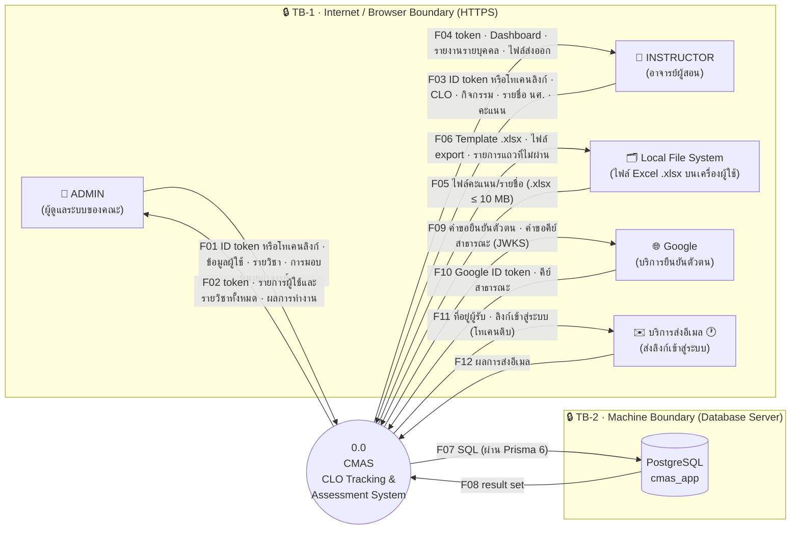
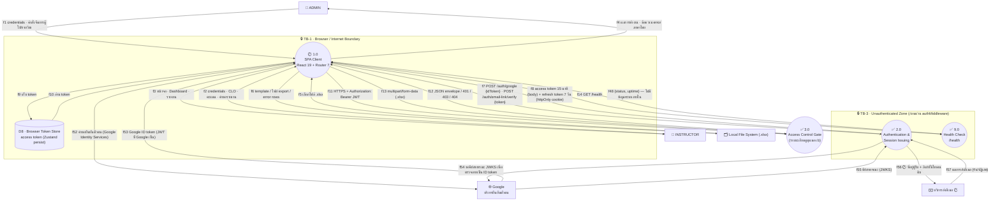
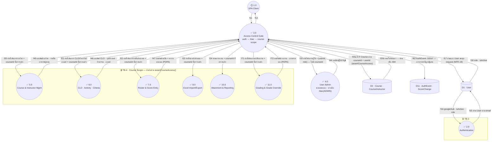
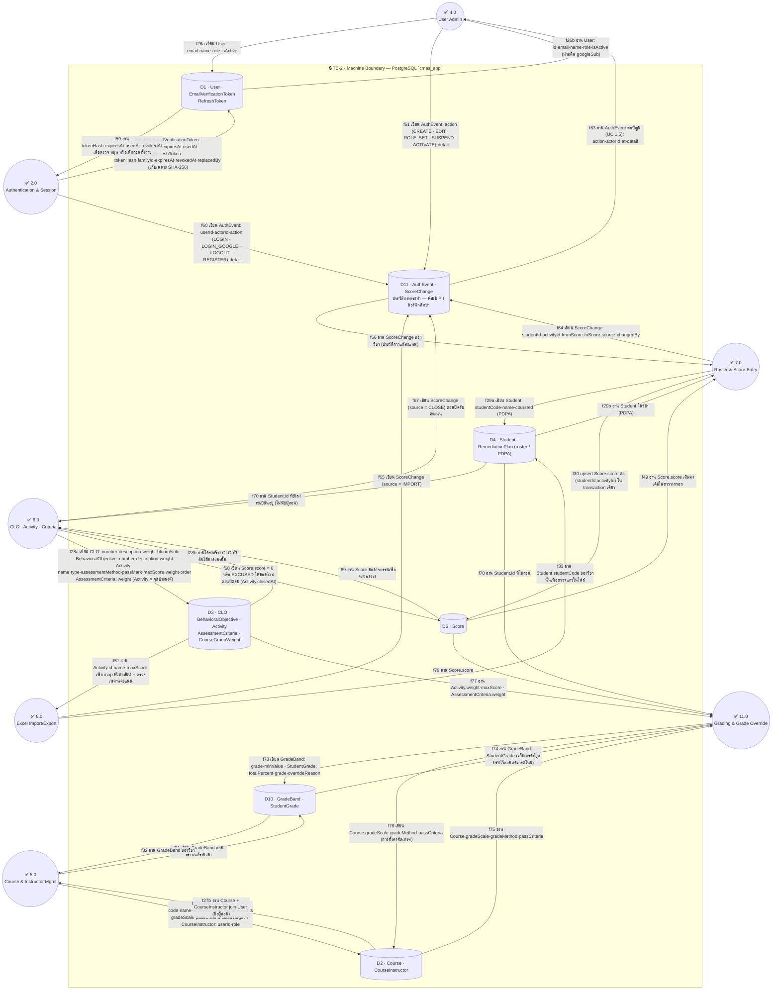
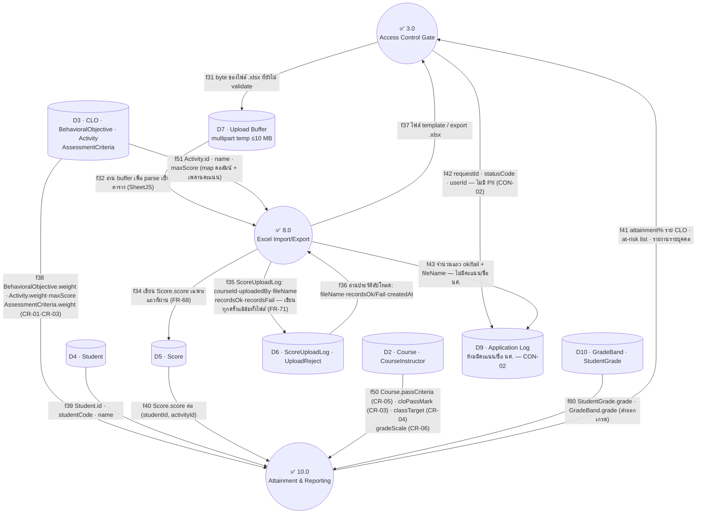
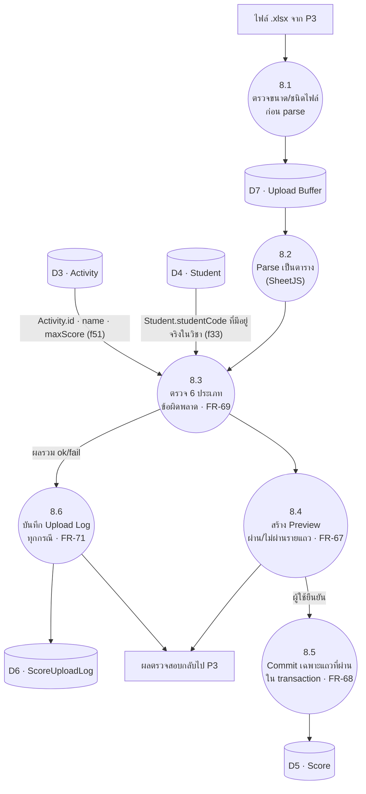
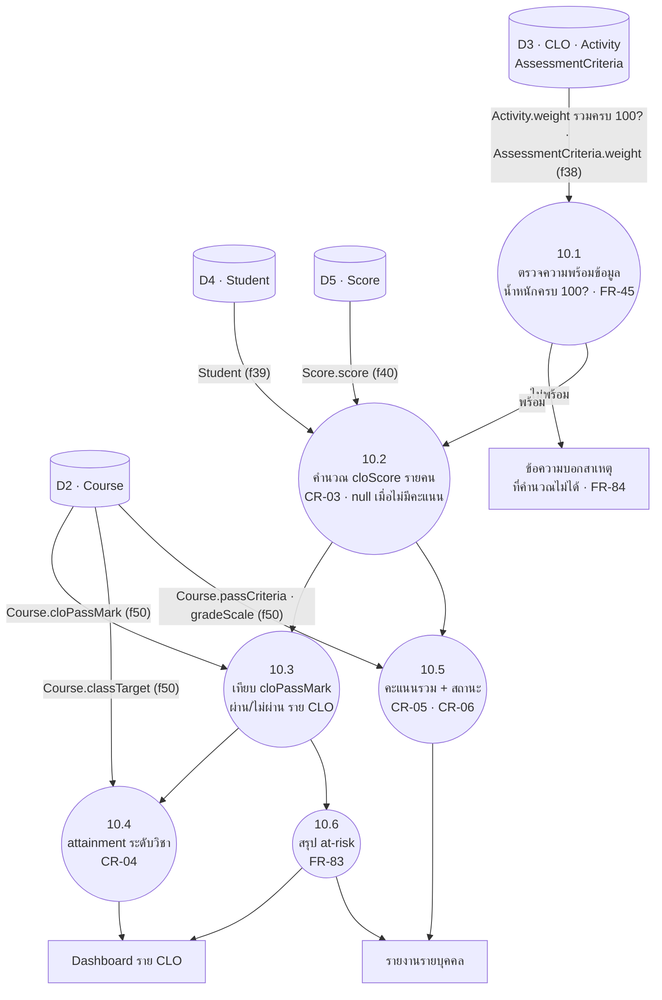

# แผนภาพกระแสข้อมูล (DFD — Data Flow Diagram) ของระบบ CMAS ระบบติดตามและประเมินผลลัพธ์การเรียนรู้ที่คาดหวังระดับรายวิชา (CLO — Course Learning Outcome)

See also: [[srs]] · [[schema]] · [[usecase]] · [[theory]] · [[project-plan]]

> **Version:** 3.0.0 | **Updated:** 2026-11-11
> **Baseline:** [[srs]] v2.5.0 · `database/schema.prisma` (**19 models · migration 0001–0008 — single-tenant** · อ่านจาก `feature/api-endpoints`) ·
> `app/server/src/middlewares/{auth,rbac}.middleware.ts` · `modules/authorization/authorization.service.ts`
> **Purpose:** เอกสารนี้เป็นทั้ง **แผนภาพกระแสข้อมูลสำหรับบทที่ 3** และ **input ของ threat modeling**
> (TMT — Microsoft Threat Modeling Tool 2016) — โครงสร้างข้อมูลยึด [[schema]] เสมอ
>
> **v2.0.0:** ตัด SUPER_ADMIN · Institution · Curriculum และ tenant boundary ออกทั้งหมด
> ตามการตัดสินใจ single-tenant (2026-08-04) — ขอบเขตข้อมูลที่เหลือคือ **รายวิชา** ไม่ใช่สถาบัน
>
> **v2.1.0 (audit):** เพิ่ม §0 อักษรย่อ · แก้จำนวน process ใน §3 (8 → 10 พร้อมตารางเทียบ SRS/route) ·
> เติม Data Flow Register ให้ครบทั้ง 43 เส้น (เดิมขาด f1–f6 · f9 · f10 · f14 · f33 · f36 · f37) ·
> เพิ่มตาราง balancing ระหว่าง Level 0 ↔ Level 1 · แก้ชื่อ TB-3 ในไดอะแกรมให้ตรงกับนิยาม §7 ·
> ทำเครื่องหมายสถานะ implement ในไดอะแกรมตามกฎข้อ 1 ของ §1
>
> **v2.2.0 (ตรวจ Level 1 ตามกฎ DFD/threat modeling — ดู §3.4):** ผิดกฎ 7 ข้อจาก 12 แก้แล้วทั้งหมด
> เพิ่มเส้นที่ขาด **f44–f49** (ขาออกของ TB-4 · การตอบของ `/health` · การอ่านคะแนนเดิม) ·
> แยกเส้นสองทางเป็น a/b (**f25 · f26 · f27 · f28 · f29**) · ตั้งชื่อเส้น f21–f24 ที่เดิมเขียนว่า `idem` ·
> แก้คอลัมน์ boundary ของ f32 · f37 · f41 · f43 ที่ตัด TB-4 จริงแต่ไม่ได้บันทึก — รวมเป็น **54 เส้น**
>
> **v2.3.0:** แยกไดอะแกรม §3 จาก 1 รูปเป็น **4 มุมมองย่อย (a)–(d)** — รูปเดียวเดิมมี P1/P3 เป็น hub
> ที่มีเส้นวิ่งเข้าออกพร้อมกัน 15+ เส้นจนอ่านไม่ออกเมื่อ render จริง เนื้อหา/ทิศทางไม่เปลี่ยน มีแต่การจัดวาง
>
> **v2.4.0:** เพิ่ม **§3.0 ภาพรวม** ก่อนมุมมองย่อย (a)–(d) — รูปเดียวเห็นทั้ง 10 process/9 store/4 boundary
> พร้อมป้ายเส้นแบบกลุ่ม (ไม่ใช่ 1:1 กับ f-id) ใช้เพื่อเห็นรูปทรงของระบบก่อนลงรายละเอียด ไม่ใช้ import เข้า TMT
>
> **v3.0.0 (2026-11-11 · ตามโค้ดและ migration `0008` บน `feature/api-endpoints`) — เพิ่ม process และ store ที่ขาด เพื่อใช้เป็น input ของ threat model ทั้งระบบ:**
> 1. **P11 ตัดเกรดและปรับเกรด** (แยกจาก P10 ที่อ่านอย่างเดียว) — เขียน `GradeBand` · `StudentGrade.overrideReason` และการตั้งค่าตัดเกรดบน `Course` ·
>    แยกเพราะเป็นการเขียนที่ต้องเชื่อถือได้ (Tampering / Repudiation) ต่างจาก P10 ที่มีแต่ความเสี่ยงด้านการเปิดเผย (โมดูล `grading`)
> 2. **D10** `GradeBand` · `StudentGrade` และ **D11 ประวัติการกระทำ** `AuthEvent` · `ScoreChange` — D11 แยกจาก D1 เพราะ threat ด้าน Repudiation ผูกกับที่เก็บนี้ ·
>    ปิดช่องว่างข้อ 8 ของ §9 (แก้คะแนนทีละช่อง f30 ไม่มี log) ส่วนข้อ 10 (เปลี่ยนเกณฑ์ตัดสิน) ยังเปิดอยู่
> 3. **external entity ใหม่ EE4 Google · EE5 บริการส่งอีเมล 🕐** — เส้น f52–f57 (Google ส่ง ID token ให้เบราว์เซอร์ และ server ขอคีย์สาธารณะ JWKS · ส่งลิงก์เข้าสู่ระบบ FR-07)
> 4. **ที่เก็บโทเคน** `EmailVerificationToken` · `RefreshToken` ใน D1 (เก็บเฉพาะ SHA-256) — เส้น f58 · f59 · refresh token อยู่ใน httpOnly cookie ไม่ใช่ใน D8
> 5. เส้นที่ขาดซึ่งเจอตอนไล่โค้ด: P6 เขียน `Score` ตอนปิดรับคะแนน (f68–f70) · P5 เขียน/อ่าน `GradeBand` ตอนสร้างรายวิชา (f81 · f82)
> 6. ตาราง `CourseGroupWeight` → D3 · `RemediationPlan` → D4 · `UploadReject` → D6 · §5.4 กระทบยอดครบ **19 model** ·
>    สถานะ implement ปรับเป็น ณ 2026-11-11 · รวมเป็น **87 เส้น** (เดิม 56) · เลิกบันทึกค้างเรื่องลิงก์อีเมลของ 2026-11-10 (ทำแล้วในรุ่นนี้)
>
> **v2.6.0 (2026-09-26 · ตามโค้ดหลัง migration `0005`–`0007`):** แก้เฉพาะสิ่งที่**ผิดจากของจริง** ไม่เพิ่มเส้นใหม่ ·
> (1) **ตัด `ObjectiveAssessment`** ออกจาก D3 ทุกที่ (0006 ยุบเข้า `AssessmentCriteria` ซึ่งผูก Activity ↔ จุดประสงค์) ·
> (2) **เกณฑ์ผ่าน CLO ย้ายจาก `CLO.threshold` เป็น `Course.cloPassMark`** — อยู่บน `Course` (= D2) จึงไหลเข้า P10 ทาง **f50** ไม่ใช่ f38 ·
> f38 เหลือ `CLO.weight` · `BehavioralObjective.weight` · `Activity.weight·maxScore` · `AssessmentCriteria.weight` ·
> (3) `Activity.method` → `type` · `assessmentMethod` · `passMark` · `criteriaNote` (f28a) ·
> (4) `User.status` เพิ่ม (PENDING/ACTIVE) — เส้น f26 ที่เขียน `User` ครอบด้วย ·
> (5) **§5.4 กระทบยอดใหม่เป็น 13 model และบันทึกอย่างตรงไปตรงมาว่า 3 ตารางยัง "ไม่มีเส้น"** —
> `GradeBand` · `StudentGrade` (ตัดเกรด, 0003) และ `EmailVerificationToken` (ลงทะเบียนด้วยอีเมล, 0005) ยังไม่ถูกวาดใน DFD นี้
> เพราะ P10 ยังนิยามเฉพาะการคำนวณ attainment · **งานค้าง (เสร็จใน v3.0.0: process 11 ตัดเกรด · store D10 `GradeBand`/`StudentGrade` · D11 ประวัติการกระทำ)**
>
> **v2.5.0 (ตรวจกับ `schema.prisma` ทีละตาราง — ดู §5.4):** เดิม data store ถูกตั้งชื่อด้วย *หมวดหมู่*
> (`D3 · CLO/Activity/Criteria`) ซึ่งอ่านไม่ออกว่าเส้นหนึ่ง ๆ แตะ **ตารางไหน** — threat model ที่บอกไม่ได้ว่า
> ข้อมูลอะไรถูกส่ง คือ threat model ที่ประเมิน Tampering ไม่ได้ แก้ทั้งหมด 5 จุด:
> 1. **D3 ขาด `ObjectiveAssessment`** — schema มี 11 model แต่ store mapping เดิมครอบได้ 10 (เพิ่ม §5.4 ตารางกระทบยอด)
> 2. **ตั้งชื่อ store ด้วยชื่อตารางจริง** ทุกที่ (ไดอะแกรม §3.0 · (c) · (d) · §5.3) — เลิกใช้คำรวมอย่าง "Criteria"
>    ที่ชี้ได้ทั้ง `AssessmentCriteria` · `CLO.threshold` · `Course.passCriteria` ซึ่งอยู่คนละตาราง
> 3. **เพิ่ม f50 (D2 → P10)** — เดิม P10 คำนวณ CR-04/05/06 โดยไม่มีเส้นส่ง `classTarget` · `passCriteria` ·
>    `gradeScale` เข้ามาเลย ทั้งสามอยู่บน `Course` (= D2) ไม่ใช่ D3 → เป็น **miracle** ตามกฎข้อ 2 ของ §3.4
> 4. **เพิ่ม f51 (D3 → P8)** — P8 ต้อง map หัวคอลัมน์ในไฟล์เป็น `activityId` และตรวจ `score ≤ maxScore`
>    แต่เดิมไม่มีเส้นอ่าน `Activity` เลย → **miracle** ข้อที่สอง
> 5. **ย้าย P4 ออกจาก TB-4** — จัดการผู้ใช้เป็นขอบเขตคณะ ไม่มี `courseId` ในเส้นทางเลย
>    ด่านจริงคือ `rbac("ADMIN")` ไม่ใช่ `assertCourseAccess()` — วาดไว้ใน TB-4 ทำให้ TMT ออก threat ผิดตัว
>
> รวมเป็น **56 เส้น** · ป้ายเส้นทุกเส้นระบุ **ตาราง.คอลัมน์** ที่แตะจริงแล้ว

---

## สารบัญ

0. [อักษรย่อและสัญลักษณ์](#0-อักษรย่อและสัญลักษณ์)
1. [หลักการเขียน DFD ชุดนี้](#1-หลักการเขียน-dfd-ชุดนี้)
2. [Level 0 — Context Diagram](#2-level-0--context-diagram)
3. [Level 1 — System Decomposition](#3-level-1--system-decomposition)
4. [Level 2 — สองกระบวนการที่ซับซ้อนที่สุด](#4-level-2--สองกระบวนการที่ซับซ้อนที่สุด)
5. [Element Register (TMT 2016 stencil mapping)](#5-element-register-tmt-2016-stencil-mapping)
6. [Data Flow Register](#6-data-flow-register)
7. [Trust Boundaries](#7-trust-boundaries)
8. [วิธีสร้างใน Threat Modeling Tool 2016](#8-วิธีสร้างใน-threat-modeling-tool-2016)
9. [STRIDE hot spots ที่ต้องตอบให้ได้](#9-stride-hot-spots-ที่ต้องตอบให้ได้)

---

## 0. อักษรย่อและสัญลักษณ์

อ่านตารางนี้ก่อนดูไดอะแกรม — ทุกตัวย่อในเอกสารนี้ถูกนิยามไว้ที่นี่ที่เดียว

### 0.1 รหัสประจำ element (ใช้อ้างอิงข้าม §2–§9)

| รูปแบบ | ความหมาย | ตัวอย่าง |
|---|---|---|
| `EEn` | **E**xternal **E**ntity — ผู้กระทำนอกระบบ (คน/ระบบอื่น) | EE1 = ADMIN |
| `Pn.n` | **P**rocess — กระบวนการที่แปลงข้อมูล | P8 = Excel Import/Export · 8.1 = process ย่อยของ P8 |
| `Dn` | **D**ata Store — ที่เก็บข้อมูล (ตาราง/ไฟล์/หน่วยความจำ) | D5 = Score |
| `TB-n` | **T**rust **B**oundary — เส้นแบ่งความเชื่อถือ | TB-4 = ขอบเขตรายวิชา |
| `Fnn` (ตัวใหญ่) | Data flow ระดับ **Level 0** | F05 = ไฟล์ .xlsx เข้าระบบ |
| `fnn` (ตัวเล็ก) | Data flow ระดับ **Level 1/2** — เป็นการแตกย่อยของ `Fnn` | f13 = multipart upload |
| `fnna` / `fnnb` | เส้นเดียวกันที่ **แยกทิศ** — `a` = ขาเขียน/ขาถาม · `b` = ขาอ่าน/ขาตอบ (TMT ไม่รับเส้นสองทาง) | f26a เขียน User · f26b อ่าน User |

### 0.2 อักษรย่อทั่วไป

| ตัวย่อ | คำเต็ม | ความหมายในบริบทนี้ |
|---|---|---|
| **CMAS** | Course Learning Outcome Management & Assessment System | ชื่อระบบที่พัฒนา |
| **CLO** | Course Learning Outcome | ผลลัพธ์การเรียนรู้ที่คาดหวังระดับรายวิชา |
| **DFD** | Data Flow Diagram | แผนภาพแสดงการไหลของข้อมูล ไม่ใช่ลำดับเวลา |
| **TMT** | (Microsoft) Threat Modeling Tool 2016 | เครื่องมือสร้าง threat list จากไดอะแกรม |
| **SDL** | Security Development Lifecycle | ชุดแนวปฏิบัติของ Microsoft ที่ TMT ใช้เป็น knowledge base |
| **STRIDE** | Spoofing · Tampering · Repudiation · Information disclosure · Denial of service · Elevation of privilege | 6 หมวดภัยคุกคามที่ TMT ใช้จำแนก |
| **EoP** | Elevation of Privilege | การยกระดับสิทธิ์ — ตัวย่อของ STRIDE ตัวสุดท้าย |
| **DoS** | Denial of Service | การทำให้ระบบใช้งานไม่ได้ |
| **PDPA** | Personal Data Protection Act (พ.ร.บ.คุ้มครองข้อมูลส่วนบุคคล) | เหตุผลที่ D4/D5 ถูกทำเครื่องหมาย Sensitive |
| **PII** | Personally Identifiable Information | ข้อมูลที่ระบุตัวบุคคลได้ — ห้ามลง D9 (CON-02) |
| **FR / NFR** | Functional / Non-Functional Requirement | ข้อกำหนดใน [[srs]] §4 / §6 |
| **CR** | Calculation Rule | กฎการคำนวณใน [[srs]] §3 (CR-01…CR-07) |
| **CON / ASM** | Constraint / Assumption | ข้อจำกัด / ข้อสมมติใน [[srs]] §2.3 |
| **UC** | Use Case | กรณีใช้งานใน [[usecase]] |
| **SPA** | Single Page Application | ไคลเอนต์ React ที่เปลี่ยนหน้าโดยไม่โหลดใหม่ (P1) |
| **JWT** | JSON Web Token | รูปแบบ token ที่ P2 ออกให้ |
| **JWKS** | JSON Web Key Set | ชุดคีย์สาธารณะที่ Google เผยแพร่ ใช้ตรวจลายเซ็นของ ID token (f54 · f55) |
| **ID token** | Google ID token | JWT ที่ Google เซ็นยืนยันตัวผู้ใช้ — server ตรวจ `aud` · `iss` · `email_verified` ก่อนเชื่อ (FR-08) |
| **RBAC** | Role-Based Access Control | การตรวจสิทธิ์ตาม role/capability ใน `access.middleware.ts` |
| **CRUD** | Create · Read · Update · Delete | ชุดปฏิบัติการพื้นฐานกับข้อมูล |
| **XSS / CSRF** | Cross-Site Scripting / Cross-Site Request Forgery | ช่องโหว่ฝั่งเบราว์เซอร์ที่กระทบวิธีเก็บ token (D8) |
| **TLS / HTTPS** | Transport Layer Security / HTTP over TLS | การเข้ารหัสระหว่างทาง |
| **SQL** | Structured Query Language | ภาษาคิวรีที่ Prisma สร้างให้ |
| **SheetJS** | ไลบรารี `xlsx` (SheetJS CE) | ตัว parse/สร้างไฟล์ `.xlsx` ใน P8 |
| **at-risk** | นักศึกษากลุ่มเสี่ยง | ผู้ที่ไม่ผ่าน CLO อย่างน้อย 1 ข้อ (FR-83) |
| **attainment** | ระดับการบรรลุ CLO | สัดส่วนผู้ผ่านเกณฑ์ (CR-04) |
| **roster** | รายชื่อนักศึกษาในวิชา | ข้อมูลใน D4 |
| **upsert** | update-or-insert | เขียนคะแนนโดยไม่ต้องรู้ว่ามีแถวเดิมอยู่หรือไม่ |
| **envelope** | รูปแบบ response มาตรฐาน | ซอง JSON `{success, data, error}` ตาม [[srs]] §5.2 |
| **single-tenant** | ใช้งานองค์กรเดียว | ไม่มีชั้นสถาบัน — ขอบเขตข้อมูลคือรายวิชา (ASM-04) |
| **target-state** | สภาพที่ตั้งใจให้เป็น | ไดอะแกรมนี้อธิบายระบบเมื่อพัฒนาเสร็จ ไม่ใช่ ณ วันนี้ |

### 0.3 สัญลักษณ์ในไดอะแกรม

| สัญลักษณ์ | ความหมาย |
|---|---|
| ✅ | implement แล้วบน `feature/api-endpoints` ณ 2026-11-11 (ยังไม่อยู่บน `develop` จนกว่า branch นั้นจะ merge) |
| 🕐 | ยังไม่ implement — มี FR รองรับและตั้งใจจะมี (ลิงก์อีเมล FR-07 · ไคลเอนต์ P1 ที่ยังสร้างไม่ครบ) · อนุญาตให้อยู่ในไดอะแกรมได้เพราะเอกสารนี้เป็น target-state (กฎข้อ 1 ของ §1) |
| 🔒 | Trust boundary |
| 👤 | External entity ที่เป็นคน |
| 🌐 · ✉️ | External entity ที่เป็นบริการภายนอก (Google · บริการส่งอีเมล) |
| 🗂️ | External entity ที่เป็นระบบไฟล์ |
| `(( ))` | Process · `[( )]` Data store · `[ ]` External entity |

---

## 1. หลักการเขียน DFD ชุดนี้

| กฎ | เหตุผล |
|---|---|
| **สิ่งที่ไม่มีในโค้ด ห้ามอยู่ในไดอะแกรม** | DFD ที่วาดจากความตั้งใจ ไม่ใช่จากระบบจริง จะให้ threat list ที่ผิด — route ที่ยัง comment ไว้ใน `modules/index.ts` ถูกทำเครื่องหมาย `(planned)` |
| **นักศึกษาไม่ใช่ external entity** | ตาม [[srs]] §2.2 นักศึกษาเป็น **ข้อมูล** ไม่ใช่ผู้ใช้ระบบใน v1 — แต่เป็น **data subject** ตาม PDPA จึงมีผลกับ Information Disclosure |
| **Middleware chain เป็น process แยก (3.0)** | `authMiddleware → rbac → assertCourseAccess` คือจุดบังคับ trust boundary ทั้งหมด ถ้ายุบรวมกับ process อื่น จะมองไม่เห็น threat ที่เกิดจาก "route ที่ลืมต่อ middleware" |
| **ขอบเขตข้อมูลคือรายวิชา ไม่ใช่สถาบัน** | single-tenant ทำให้เหลือ boundary เดียว (TB-4) และ**บังคับที่ชั้นแอปพลิเคชัน** (`assertCourseAccess`) ไม่ใช่ที่ network layer — ต้องเขียนกำกับไว้ในโมเดล |
| **Excel file = ช่องทางรับ input ที่ไม่น่าเชื่อถือ** | ไฟล์ผู้ใช้อัปโหลดคือ untrusted input ที่ข้าม trust boundary — ต้องเป็น data flow ของตัวเอง ไม่ใช่รายละเอียดใน process |

---

## 2. Level 0 — Context Diagram

ระบบทั้งหมดเป็น **1 process** มองจากภายนอก — ตอบคำถามเดียว: ใครคุยกับระบบ และคุยเรื่องอะไร

> **หมายเหตุ Level 0:** ไม่มี SUPER_ADMIN แล้ว — single-tenant ทำให้ไม่มีชั้นที่อยู่เหนือ ADMIN
> ความต่างของสิทธิ์ที่เหลือคือ **ADMIN เห็นทุกรายวิชา ส่วน INSTRUCTOR เห็นเฉพาะวิชาที่ถูกมอบหมาย**
> ซึ่งเป็นเรื่องของขอบเขตข้อมูล (TB-4) ไม่ใช่ระดับ privilege ที่ต่างกันคนละชั้น

---

## 3. Level 1 — System Decomposition

แตก process 0.0 ออกเป็น **11 process** — 1 ฝั่งไคลเอนต์ (P1) · 1 ด่านตรวจสิทธิ์ (P3) ·
9 กระบวนการฝั่งเซิร์ฟเวอร์ที่ล้อกับ §4 ของ [[srs]] (เพิ่ม P11 ตัดเกรดใน v3.0.0)

> **หมายเหตุการอ่าน:** Level 1 เต็มมี 87 เส้น — วาดรวมรูปเดียวแล้วอ่านไม่ออก (P1/P3 กลายเป็น hub)
> จึงแยกเป็น **4 มุมมองย่อย (a)–(d)** ตามโซนความไว้ใจ node ที่ปรากฏซ้ำในหลายรูป (เช่น P3, P7, P8)
> คือ **process เดียวกัน** ไม่ใช่คนละตัว — มุมมองที่รวมทุกเส้นเข้าด้วยกันคือ §6 Data Flow Register
>
> การตรวจกฎ black hole/miracle (ข้อ 1–2 ของ §3.4) ต้องดูที่ **ผลรวมของทั้ง 4 มุมมอง** ไม่ใช่ทีละรูป —
> node บางตัว (เช่น P3edge ในมุมมอง (a)) จงใจตัดขาให้เหลือเฉพาะเส้นที่เกี่ยวกับโซนนั้น ไม่ใช่ node จริงที่ไม่ครบ
> **สำหรับ TMT 2016 ให้วาดรวมเป็นผืนเดียวตาม §8** — การแยก 4 รูปนี้มีไว้เพื่ออ่านในเอกสารเท่านั้น

### 3.0 ภาพรวม (Overview) — ก่อนดูรายละเอียด 4 มุมมอง

รูปนี้แสดง **รูปทรง (shape)** ของระบบ: 11 process · 11 data store · 4 trust boundary
โดยยุบเส้นแต่ละ f-id ให้เหลือเป็น**กลุ่มความสัมพันธ์**ต่อคู่ node — ไม่ใช่ข้อมูลสำหรับ import เข้า TMT
(ให้ใช้มุมมอง (a)–(d) หรือ §6 Data Flow Register แทนเมื่อทำ threat modeling จริง)

```mermaid
flowchart TB
    EE1["👤 ADMIN"]
    EE2["👤 INSTRUCTOR"]
    EE3["🗂️ Local File System (.xlsx)"]
    EE4["🌐 Google"]
    EE5["✉️ บริการส่งอีเมล 🕐"]

    subgraph TB1 ["🔒 TB-1 · Browser / Internet"]
        P1(("🕐 1.0<br/>SPA Client"))
        DS8[("D8 · Token Store")]
    end

    subgraph APP ["API Server — Fastify 5"]
        subgraph TB3 ["🔒 TB-3 · Unauthenticated"]
            P2(("✅ 2.0<br/>Auth & Session"))
            P9(("✅ 9.0<br/>Health"))
        end

        P3(("✅ 3.0<br/>Access Control Gate"))

        P4(("✅ 4.0<br/>User Admin<br/>ระดับคณะ — นอก TB-4"))

        subgraph TB4 ["🔒 TB-4 · Course Scope"]
            P5(("✅ 5.0<br/>Course & Instructor"))
            P6(("✅ 6.0<br/>CLO · Activity · Criteria"))
            P7(("✅ 7.0<br/>Roster & Score Entry"))
            P8(("✅ 8.0<br/>Excel Import/Export"))
            P10(("✅ 10.0<br/>Attainment & Reporting"))
            P11(("✅ 11.0<br/>Grading & Grade Override"))
        end

        DS7[("D7 · Upload Buffer")]
        DS9[("D9 · App Log")]
    end

    subgraph TB2 ["🔒 TB-2 · PostgreSQL — cmas_app"]
        DS1[("D1 · User · EmailVerificationToken<br/>RefreshToken")]
        DS2[("D2 · Course<br/>CourseInstructor")]
        DS3[("D3 · CLO · BehavioralObjective · Activity<br/>AssessmentCriteria · CourseGroupWeight")]
        DS4[("D4 · Student · RemediationPlan")]
        DS5[("D5 · Score")]
        DS6[("D6 · ScoreUploadLog · UploadReject")]
        DS10[("D10 · GradeBand · StudentGrade")]
        DS11[("D11 · AuthEvent · ScoreChange<br/>ประวัติการกระทำ")]
    end

    EE1 == "จัดการผู้ใช้/รายวิชา (f1,f4)" ==> P1
    EE2 == "CLO/คะแนน/รายงาน (f2,f3)" ==> P1
    EE3 == "ไฟล์ .xlsx (f5,f6)" ==> P1

    P1 == "login/token (f7-f10)" ==> P2
    P1 == "API + upload (f11-f13)" ==> P3
    P1 == "health (f14,f48)" ==> P9
    P1 == "คำขอ/ID token ของ Google (f52,f53)" ==> EE4
    P2 == "คีย์สาธารณะ JWKS (f54,f55)" ==> EE4
    P2 == "ลิงก์เข้าสู่ระบบ / ผลการส่ง 🕐 (f56,f57)" ==> EE5
    P2 == "User.googleSub · role · isActive ตาม email (f15,f16)" ==> DS1
    P2 == "โทเคนลิงก์ · refresh token เก็บเฉพาะ hash (f58,f59)" ==> DS1
    P3 == "User.role · isActive สดทุก request (f17,f18)" ==> DS1

    P3 == "คำสั่ง/ผลลัพธ์บัญชีผู้ใช้ — ไม่มี courseId (f19,f44)" ==> P4
    P3 == "คำสั่ง/ผลลัพธ์รายวิชา + courseId (f20,f45)" ==> P5
    P3 == "คำสั่ง/ผลลัพธ์ CLO·Activity·Criteria + courseId (f21,f46)" ==> P6
    P3 == "คำสั่ง/ผลลัพธ์รายชื่อ·คะแนน + courseId (f22,f47)" ==> P7
    P3 == "คำสั่ง/ผลลัพธ์ import·export + courseId (f23,f37)" ==> P8
    P3 == "คำขอ/ผลรายงาน + courseId (f24,f41)" ==> P10
    P3 == "คำสั่ง/ผลตัดเกรด + courseId (f71,f72)" ==> P11
    P3 == "Course.id WHERE instructors.userId (f25a,f25b)" ==> DS2

    P4 == "User: email·name·role·isActive (f26a,f26b)" ==> DS1
    P5 == "Course: code·credits·gradeScale·passCriteria·classTarget<br/>+ CourseInstructor.role (f27a,f27b)" ==> DS2
    P6 == "CLO.weight · BehavioralObjective.weight<br/>Activity.maxScore·weight·passMark<br/>AssessmentCriteria.weight (f28a,f28b)" ==> DS3
    P7 == "Student.studentCode · name (PDPA) (f29a,f29b)" ==> DS4
    P7 == "Score.score ต่อคู่ studentId+activityId (f30,f49)" ==> DS5

    P3 == "ไฟล์ .xlsx ดิบ ยังไม่ validate (f31)" ==> DS7
    DS7 == "byte ของไฟล์ → ตาราง (SheetJS) (f32)" ==> P8
    DS3 == "Activity.id·name·maxScore เพื่อ map คอลัมน์ (f51)" ==> P8
    P8 == "Student.studentCode ในวิชานั้น (f33)" ==> DS4
    P8 == "Score.score เฉพาะแถวที่ผ่าน (f34)" ==> DS5
    P8 == "ScoreUploadLog: fileName·recordsOk·recordsFail (f35,f36)" ==> DS6
    P8 == "ไฟล์ template / export .xlsx (f37)" ==> P3

    DS3 == "CLO.weight · BehavioralObjective.weight<br/>Activity.weight·maxScore<br/>AssessmentCriteria.weight (f38)" ==> P10
    DS4 == "Student.studentCode · name (f39)" ==> P10
    DS5 == "Score.score รายกิจกรรม (f40)" ==> P10
    DS2 == "Course.passCriteria·cloPassMark·classTarget·gradeScale (f50)" ==> P10
    P10 == "attainment% · at-risk · รายงานรายบุคคล (f41)" ==> P3

    P3 == "requestId · status · userId — ไม่มี PII (f42)" ==> DS9
    P11 == "GradeBand · StudentGrade + overrideReason (f73,f74)" ==> DS10
    P11 == "Course.gradeScale·gradeMethod·passCriteria (f75,f76)" ==> DS2
    DS3 == "weight · maxScore (f77)" ==> P11
    DS4 == "Student.id (ไม่นับผู้ถอน) (f78)" ==> P11
    DS5 == "Score.score (f79)" ==> P11
    DS10 == "StudentGrade.grade (f80)" ==> P10
    P5 == "GradeBand ตอนสร้าง/แก้รายวิชา (f81,f82)" ==> DS10
    P2 == "AuthEvent: เข้า/ออกระบบ (f60)" ==> DS11
    P3 == "AuthEvent: DENY (f62)" ==> DS11
    P4 == "AuthEvent: ROLE_SET · SUSPEND … (f61,f63)" ==> DS11
    P7 == "ScoreChange รายช่อง (f64,f66)" ==> DS11
    P8 == "ScoreChange (f65)" ==> DS11
    P6 == "ปิดรับคะแนน: เติม Score + ScoreChange (f67,f68,f69,f70)" ==> DS11
    P8 == "จำนวนแถว ok/fail — ไม่มีคะแนน/ชื่อ (f43)" ==> DS9
```

> **ป้ายเส้นในรูปนี้เป็นกลุ่ม f-id** ไม่ใช่ 1 เส้น = 1 ป้าย — เช่น `(f26a,f26b)` คือมีเส้นเขียนและเส้นอ่าน
> จริง 2 เส้นแยกกัน (ดูมุมมอง (c)) รูปนี้บอกว่า *มีความสัมพันธ์อะไร และส่งฟิลด์อะไร* ระหว่าง node สองตัว
> แต่ไม่ได้บอกทิศและจำนวนเส้นที่แท้จริง — ต้องดูมุมมอง (a)–(d) หรือ §6 สำหรับรายละเอียด
>
> **ทำไมป้ายเส้นถึงต้องระบุ `ตาราง.คอลัมน์`:** TMT ออก Tampering threat ต่อ *เส้น* ไม่ใช่ต่อ *ตาราง*
> ป้ายว่า "CRUD" บอกไม่ได้ว่าการแก้เส้นนั้นกระทบอะไร แต่ป้ายว่า `Activity.weight` บอกทันทีว่า
> การแก้ค่าระหว่างทางจะ **เขียนผลคำนวณ attainment ของทั้งวิชาใหม่** โดยไม่มีใครเห็น (CR-01)
> — ป้ายที่ระบุฟิลด์คือสิ่งที่ทำให้ §9 STRIDE hot spot เขียนได้จริง

### (a) ผู้ใช้ ↔ ไคลเอนต์ ↔ Auth/Health (f1–f14 · f48)

### (b) ด่านตรวจสิทธิ์ ↔ กระบวนการหลัก — TB-4 (f15–f25b · f44–f47)

> **ทิศเข้า (f20–f25a) = ภัยหลัก EoP/Tampering** — เดินตรวจว่า `courseId` ถูกยึดถูกก่อนวิ่งเข้า
> **ทิศออก (f45–f47) = ภัยหลัก Information Disclosure** — เดินตรวจว่าผลลัพธ์ที่ตอบกลับ scope ตาม `courseId` เดียวกันจริง
>
> **f19/f44 ไม่ตัด TB-4 (แก้ใน v2.5.0):** เส้นทางจัดการผู้ใช้ไม่มี `courseId` อยู่ในนั้นเลย —
> `usersRoutes` ถูกกันด้วย `config.access = { cap: "user.manage" }` ([access.middleware.ts](../../../../app/server/src/middlewares/access.middleware.ts))
> ไม่ใช่ `assertCourseAccess()` การวาด P4 ไว้ใน TB-4 ทำให้ TMT ออก threat "cross-course" กับเส้นที่
> ไม่มีวันมี course อยู่ในนั้น ขณะที่ threat จริงของ P4 คือ **EoP ระดับ role** (INSTRUCTOR ตั้ง role ตัวเองเป็น ADMIN)
> ซึ่งเป็นคนละตัว — ดู §9 ข้อ 9

### (c) กระบวนการหลัก ↔ ฐานข้อมูล — TB-2 (f26a–f30 · f33 · f49 · f51)

ทุกป้ายเส้นในรูปนี้ระบุ **ตาราง.คอลัมน์** ตาม `database/schema.prisma` — ไม่ใช้คำรวมอย่าง "CRUD"

> **f51 คือเส้นที่ v2.4.0 ขาดไป** — ถ้าไม่มีเส้นนี้ P8 จะไม่มีทางรู้ว่าหัวคอลัมน์ `"สอบกลางภาค"` ในไฟล์
> หมายถึง `Activity.id` ตัวไหน และไม่มีทางตรวจ `score ≤ maxScore` ได้ก่อนเขียน
> (`maxScore` ถูกบังคับซ้ำด้วย trigger ที่ชั้น DB ตาม comment หัวไฟล์ `schema.prisma` — แต่ FR-69
> ต้องรายงานความผิดให้ผู้ใช้เห็นเป็นรายแถว **ก่อน** commit ไม่ใช่ปล่อยให้ transaction ระเบิด)

### (d) สายไฟล์ Excel ↔ รายงาน ↔ Log (f31–f43 · f50 · f51)

> **f50 คือเส้นที่ v2.4.0 ขาดไป** — เกณฑ์ตัดสินทั้งสามตัวอยู่บนตาราง `Course` (= **D2**) ไม่ใช่ D3:
> `passCriteria` (ผ่านรายวิชากี่ %) · `classTarget` (ผู้ผ่านกี่ % จึงถือว่าบรรลุ CLO) · `gradeScale`
> (LETTER หรือ PASS_FAIL) เดิม P10 จึงเป็น **miracle** — ผลิตคำว่า "บรรลุ/ไม่บรรลุ" ออกมาโดยไม่มีเส้นใด
> ส่งเกณฑ์เข้ามาเลย
>
> **ผลด้าน threat ที่เพิ่งมองเห็นได้เพราะมี f50:** `passCriteria`/`classTarget` เป็น **course-level**
> (comment OI-03 ใน `schema.prisma`) — ใครแก้ค่านี้ผ่าน f27a คือการ**เปลี่ยนผลประเมินย้อนหลังทั้งวิชา**
> โดยไม่แตะคะแนนสักตัวเดียวและไม่มี log ใด ๆ จับได้ (D6 บันทึกเฉพาะการนำเข้าไฟล์) — ดู §9 ข้อ 10

> **สิ่งที่ยังไม่ถูก implement (ณ 2026-08-05):** ทุก process ที่ทำเครื่องหมาย 🕐 — คือ 1.0–8.0 และ 10.0
> route ยังถูก comment ไว้ใน `app/server/src/modules/index.ts` มีเพียง ✅ 9.0 `/health` ที่ทำงานจริง
> DFD นี้จึงเป็น **target-state model** ใช้ทำ threat modeling **ก่อน** implement ไม่ใช่หลัง
> (ข้อยกเว้น: `modules/authorization/authorization.service.ts` เขียนเสร็จแล้ว แต่ยังไม่มี route เรียกใช้)

### 3.1 ตารางเทียบ process ↔ ข้อกำหนด ↔ โค้ด

ตารางนี้คือหลักฐานว่าไดอะแกรมมาจากระบบจริง ไม่ใช่จากความตั้งใจ (กฎข้อ 1 ของ §1)

| Process | ที่มาใน [[srs]] | โมดูล route (`app/server/src/modules/`) | สถานะ ณ 2026-11-11 |
|---|---|---|---|
| P1 SPA Client | §5.1 User Interface | — (ฝั่ง client) | 🕐 สร้างบางหน้า (เข้าสู่ระบบ · ผู้ใช้ · รายวิชา) |
| P2 Authentication & Session | §4.1 (FR-01 · FR-07 · FR-08) | `auth` (`auth.route.ts` · `session.service.ts` · `refresh-token.repository.ts`) | ✅ Google + refresh + logout · 🕐 ลิงก์อีเมล (`/auth/email-link*`) |
| P3 Access Control Gate | NFR-07 · NFR-19 · FR-25 | `middlewares/access.middleware.ts` + `authorization` | ✅ |
| P4 User Administration | §4.1 (FR-05 · FR-08b) | `users` | ✅ **นอก TB-4** (ไม่มี `:courseId`) |
| P5 Course & Instructor Mgmt | §4.3 (FR-20…FR-29) | `courses` | ✅ |
| P6 CLO · Activity · Criteria | §4.4 + §4.5 (FR-30…FR-48) | `clos` + `activities` | ✅ |
| P7 Roster & Score Entry | §4.6 + §4.7 ส่วนกรอกมือ (FR-50…FR-65) | `students` + `scores` | ✅ |
| P8 Excel Import/Export | §4.7 ส่วนไฟล์ (FR-66…FR-71) | เส้นทาง import / template ใน `students` และ `scores` | ✅ |
| P9 Health Check | — (infrastructure) | `health` | ✅ |
| P10 Attainment Calc & Reporting | §4.8 (FR-80…FR-88) | `dashboard` | ✅ อ่านอย่างเดียว |
| **P11 Grading & Grade Override** | §4.8 ส่วนตัดเกรด · CR-06 | `grading` | ✅ **ใหม่ใน v3.0.0** |

### 3.2 ช่องว่างที่พบตอน audit

**2026-08-05:** `modules/index.ts` วางแผนไว้ 6 โมดูลแต่ DFD มี 8 process ฝั่งเซิร์ฟเวอร์ — ส่วนที่ไม่มีเจ้าภาพคือ P7 (roster + กรอกคะแนนทีละช่อง)
**ปิดแล้ว:** โค้ดบน `feature/api-endpoints` มี 11 โมดูล (P7 เป็น `students` + `scores` · P8 เป็นเส้นทาง import ในสองโมดูลนั้น)

**2026-11-11 (v3.0.0):** ไล่โมดูลและตารางของ migration `0008` เทียบกับไดอะแกรมพบช่องว่างที่ต้องเติม — ดู §3.6 (ข้อ 18–23)
ส่วนที่ยังเปิดอยู่: **ไม่มี audit ของการเปลี่ยนเกณฑ์ตัดสินบน `Course`** (§9 ข้อ 10) และ **ลิงก์อีเมลยังไม่มี endpoint** (🕐)

### 3.3 Balancing — Level 0 ↔ Level 1

กฎของ DFD: เส้นทุกเส้นที่เข้า/ออก process ระดับบน ต้องปรากฏครบในระดับที่แตกลงไป
ตารางนี้ทำให้ตรวจได้ว่าไม่มีข้อมูลหายหรืองอกระหว่างระดับ

| Level 0 | ทิศทาง | แตกเป็น Level 1 |
|---|---|---|
| **F01** ADMIN → ระบบ | เข้า | f1 → f7 · f11 |
| **F02** ระบบ → ADMIN | ออก | f8 · f44 · f45 → f12 → f4 |
| **F03** INSTRUCTOR → ระบบ | เข้า | f2 → f7 · f11 · f13 (ตัดเกรด: f11 → f71) |
| **F04** ระบบ → INSTRUCTOR | ออก | f8 · f41 · f45–f47 · f72 → f12 → f3 |
| **F05** ไฟล์ .xlsx → ระบบ | เข้า | f5 → f13 → f31 → f32 |
| **F06** ระบบ → ไฟล์ | ออก | f37 → f12 → f6 |
| **F07** ระบบ → ฐานข้อมูล | เข้า DB | f15 · f17 · f25a · f26a–f29a · f30 · f33 · f34 · f35 · f58 · f60–f62 · f64 · f65 · f67 · f68 · f73 · f76 · f81 |
| **F08** ฐานข้อมูล → ระบบ | ออก DB | f16 · f18 · f25b · f26b–f29b · f36 · f38–f40 · f49 · **f50** · **f51** · f59 · f63 · f66 · f69 · f70 · f74 · f75 · f77–f79 · f80 · f82 |
| **F09** ระบบ → Google | ออก | f52 · f54 |
| **F10** Google → ระบบ | เข้า | f53 · f55 |
| **F11** ระบบ → บริการส่งอีเมล 🕐 | ออก | f56 |
| **F12** บริการส่งอีเมล 🕐 → ระบบ | เข้า | f57 |

> เส้นที่ **ไม่มี** คู่ใน Level 0 มีสองกลุ่มและถูกต้องทั้งคู่ เพราะเป็นการไหล**ภายใน**ขอบเขตเดียว:
> f9/f10 (client ↔ D8 อยู่ในเบราว์เซอร์) และ f42/f43 (log ภายในเซิร์ฟเวอร์)
> ส่วน f14/f48 (`/health`) ไม่ปรากฏใน Level 0 เพราะไม่ใช่ข้อมูลของผู้ใช้ — เป็น flow ของ infrastructure

### 3.4 ผลตรวจ Level 1 ตามกฎ DFD และกฎของ threat modeling

ตรวจเมื่อ 2026-08-05 · เกณฑ์: กฎโครงสร้าง DFD แบบ Yourdon/DeMarco (ข้อ 1–8) +
กฎเฉพาะของ TMT 2016 ที่มีผลกับการ generate threat (ข้อ 9–12)

| # | กฎ | ผลตรวจ | สิ่งที่ทำ |
|---|---|---|---|
| 1 | **ห้ามมี black hole** — process ที่มีขาเข้าแต่ไม่มีขาออก | ❌ **P9** รับ f14 แล้วไม่ตอบอะไรเลย | เพิ่ม **f48** P9 → P1 |
| 2 | **ห้ามมี miracle** — ข้อมูลขาออกที่ไม่มีที่มา | ❌ **f12** (response ถึงผู้ใช้) ไม่มีเส้นป้อนเข้า P3 จาก P4–P7 เลย ทั้งที่ทั้งสี่ process อ่านฐานข้อมูลจริง | เพิ่ม **f44–f47** P4/P5/P6/P7 → P3 |
| 3 | **ทุก data store ต้องมีทั้งคนอ่านและคนเขียน** | ⚠️ **D5** ถูกเขียนโดย P7/P8 และอ่านโดย P10 แต่ **P7 ไม่เคยอ่าน** — หน้าจอกรอกคะแนนจะแสดงคะแนนเดิมไม่ได้ · **D9** เขียนอย่างเดียว | เพิ่ม **f49** D5 → P7 · D9 รับเป็นข้อยกเว้น (ดูหมายเหตุใต้ตาราง) |
| 4 | **ห้ามต่อ store → store โดยตรง** | ✅ ไม่มี | — |
| 5 | **ห้ามต่อ external entity → external entity** | ✅ ไม่มี | — |
| 6 | **ห้ามต่อ external entity → data store โดยตรง** | ✅ EE3 ผ่าน P1 เสมอ | — |
| 7 | **ทุกเส้นต้องมีชื่อที่บอก "ข้อมูลอะไร"** | ❌ f21–f24 เขียนว่า `idem` ซึ่งไม่ใช่ชื่อข้อมูล — import เข้า TMT แล้วจะกลายเป็นเส้นไม่มีชื่อ 4 เส้น | ตั้งชื่อจริงทั้งสี่เส้น |
| 8 | **Balancing กับระดับบน** | ✅ ครบทั้ง 8 เส้นของ Level 0 | ดู §3.3 |
| 9 | **TMT ไม่มีเส้นสองทาง** — flow มีทิศเดียวเสมอ และ threat ต่างกันตามทิศ | ❌ f26–f29 วาดเป็น `<-->` และ f25 วาดทางเดียวแต่ register เขียน `↔` | แยกเป็น **f25a/b · f26a/b · f27a/b · f28a/b · f29a/b** |
| 10 | **เส้นที่ตัดขอบเขตต้องถูกบันทึกว่าตัดขอบเขต** | ❌ f32 · f37 · f41 · f43 ตัด **TB-4** จริง (D7/D9/P3 อยู่นอกกรอบ TB-4 แต่ P8/P10 อยู่ใน) แต่ register เดิมเขียนว่า `—` | แก้คอลัมน์ boundary ใน §6 |
| 11 | **ขอบเขตต้องมีเส้นตัดทั้งสองทิศ** ไม่ใช่ขาเข้าอย่างเดียว | ❌ เดิม TB-4 มีแต่ขาเข้า (f19–f24) — **ทิศที่ข้อมูลรั่วคือขาออก** แต่ไม่มีเส้นให้ TMT เห็น | f44–f47 ปิดช่องนี้พอดี |
| 12 | **ชนิด stencil ต้องตรงกับสิ่งที่ element เป็นจริง** | ✅ ตรงกับ §5 ทั้ง 22 element | — |

**สรุป: ผิดกฎ 7 ข้อจาก 12** — แก้ในไดอะแกรมและ register แล้วทั้งหมด จำนวนเส้นเพิ่มจาก 43 เป็น **54**
(ใช้วิธีเติมเลขใหม่ f44–f49 และแยกด้วยตัวอักษร a/b แทนการเรียงเลขใหม่ทั้งชุด
เพราะ [[project-plan]] และ [[srs]] อ้างเลขเส้นเดิมอยู่ — การ renumber จะทำให้เอกสารอื่นผิดตามทันที)

### 3.5 ผลตรวจรอบสอง — เทียบกับ `schema.prisma` ทีละตาราง (v2.5.0)

รอบ v2.2.0 ตรวจ **โครงสร้างไดอะแกรม** (black hole / miracle / ทิศ) แต่ตรวจจาก*ไดอะแกรมเอง*
รอบนี้ตรวจอีกแกนหนึ่ง: **ไดอะแกรมตรงกับฐานข้อมูลจริงหรือไม่** — เปิด `database/schema.prisma`
ไล่ทีละ model แล้วถามว่า "ตารางนี้อยู่ใน store ไหน และมีเส้นอ่าน/เขียนครบไหม"
กฎที่ใช้คือ **miracle รุ่นละเอียด**: process ที่ผลิตค่าจากคอลัมน์ที่ไม่มีเส้นส่งเข้ามา = miracle เหมือนกัน

| # | สิ่งที่พบ | ประเภท | สิ่งที่ทำ |
|---|---|---|---|
| 13 | `ObjectiveAssessment` ไม่ปรากฏใน store ใดเลย — D3 ครอบ 4 ตาราง แต่ schema มี 5 ตารางในคลัสเตอร์นี้ ทำให้ 11 model แมปได้จริงแค่ 10 | element หาย | เติมชื่อตารางใน D3 ทุกที่ + เพิ่ม **§5.4 ตารางกระทบยอด 11 model** |
| 14 | ชื่อ store เป็น**หมวดหมู่** ไม่ใช่ชื่อตาราง (`D3 · CLO/Activity/Criteria`) — คำว่า "Criteria" ชี้ได้ทั้ง `AssessmentCriteria` · `CLO.threshold` · `Course.passCriteria` ซึ่งอยู่คนละตารางและคนละ store | ป้ายกำกวม | ตั้งชื่อ store ด้วยชื่อ model จริง · ป้ายเส้นทุกเส้นระบุ `ตาราง.คอลัมน์` |
| 15 | **P10 ไม่มีเส้นรับเกณฑ์ตัดสิน** — CR-04 อ่าน `Course.classTarget` · CR-05 อ่าน `Course.passCriteria` · CR-06 อ่าน `Course.gradeScale` ทั้งหมดอยู่บน **D2** แต่ P10 ต่อกับ D3/D4/D5 เท่านั้น | **miracle** | เพิ่ม **f50** D2 → P10 |
| 16 | **P8 ไม่มีเส้นรับ Activity** — import ต้องแปลงหัวคอลัมน์เป็น `activityId` และตรวจ `score ≤ Activity.maxScore` ก่อน commit (FR-69) แต่ไม่มีเส้นอ่าน D3 | **miracle** | เพิ่ม **f51** D3 → P8 |
| 17 | **P4 ถูกวาดไว้ใน TB-4** ทั้งที่เส้นทางจัดการผู้ใช้ไม่มี `courseId` — ด่านคือ `rbac("ADMIN")` ไม่ใช่ `assertCourseAccess()` | boundary ผิดตัว | ย้าย P4 ออกนอก TB-4 · แก้คอลัมน์ boundary ของ f19/f44 เป็น `—` · เพิ่ม STRIDE ข้อ 9 |

**สรุปรอบสอง: พบ 5 ข้อ แก้ครบ** — จำนวนเส้นเพิ่มจาก 54 เป็น **56** (f50 · f51)
ทั้งสองเส้นที่เพิ่มเป็น **miracle ชนิดที่ไดอะแกรมมองไม่เห็น**: ผังเดิม "ถูก" ในแง่ว่าทุก process มีขาเข้าและขาออก
แต่ผิดในแง่ที่ว่า *ขาเข้าที่มีอยู่ไม่พอจะผลิตขาออกนั้นได้จริง* — ตรวจเจอได้ก็ต่อเมื่อเทียบกับ schema เท่านั้น

> **ข้อยกเว้นที่รับไว้อย่างตั้งใจ — D9 เขียนอย่างเดียว:** ตามกฎข้อ 3 store ที่ไม่มีใครอ่านคือ store ที่ตายแล้ว
> แต่ D9 ถูกอ่านผ่าน**เครื่องมือ ops นอกระบบ** (`docker logs` / ไฟล์บนเครื่อง) ไม่ใช่ผ่าน process ใดใน DFD นี้
> การลากเส้นอ่านออกไปหา "ผู้ดูแลเซิร์ฟเวอร์" จะเพิ่ม external entity ที่ไม่มีในขอบเขต [[srs]] v1
> **ผลด้าน threat:** ต้องบันทึกใน TMT ว่า D9 ไม่มี access control ในระดับแอป — ใครเข้าเครื่องได้ก็อ่านได้
> จึงเป็นเหตุผลที่ CON-02 (ห้ามมี PII ใน log) ไม่ใช่แค่เรื่องความสะอาด แต่เป็น control ตัวเดียวที่ป้องกัน D9

> **ข้อสังเกตที่เจอระหว่างตรวจแต่ยังไม่แก้ (อยู่ที่ Level 2):** ใน §4.1 เส้น `8.4 → 8.5` ติดป้ายว่า
> "ผู้ใช้ยืนยัน" ซึ่งเป็น **control flow ไม่ใช่ data flow** — DFD ไม่รับเส้นควบคุม
> ที่ถูกต้องคือให้ผู้ใช้ส่ง "คำสั่ง commit + id ของชุด preview" กลับเข้ามาเป็นข้อมูล
> ต้องแก้ตอนทำงาน 3.2.3 พร้อมกับตัดสินใจว่า preview ถูกเก็บที่ไหนระหว่างรอผู้ใช้ยืนยัน

### 3.6 ผลตรวจรอบสาม — เทียบกับโค้ดและ migration `0008` (v3.0.0)

ตรวจ 2026-11-11 ด้วยวิธีเดียวกับรอบสอง: ไล่ทีละ model ของ `schema.prisma` (19 ตัว) และทีละโมดูลใน `app/server/src/modules/` (11 ตัว)
ถามว่า "ใครเขียน ใครอ่าน และมีเส้นในไดอะแกรมหรือไม่"

| # | สิ่งที่พบ | ประเภท | สิ่งที่ทำ |
|---|---|---|---|
| 18 | `GradeBand` · `StudentGrade` ไม่มี process และเส้น — โมดูล `grading` เขียนทั้งสองตารางและ `Course.gradeScale·gradeMethod·passCriteria` | process ขาด | เพิ่ม **P11** · **D10** · f71–f80 |
| 19 | `AuthEvent` · `ScoreChange` ไม่มีเส้น — `AuthEvent` เขียนโดย P2 (เข้า/ออกระบบ) P4 (เปลี่ยน role/สถานะ) และด่าน P3 (DENY) · `ScoreChange` เขียนผ่าน `writeCells` โดย P7 P8 P6 | store ขาด | เพิ่ม **D11** · f60–f67 · f66 |
| 20 | `RefreshToken` · `EmailVerificationToken` ไม่มีเส้น | store ขาด | เพิ่ม f58 · f59 (เก็บเฉพาะ SHA-256) |
| 21 | ไม่มี external entity ของ Google (ตรวจ ID token ต้องใช้คีย์ JWKS) และบริการส่งอีเมล (FR-07) | entity ขาด | เพิ่ม **EE4 · EE5** · f52–f57 |
| 22 | **P6 เขียน `Score`** ตอนปิดรับคะแนน (`activity.repository.ts` เรียก `writeCells` ด้วย source `CLOSE`) แต่ไม่มีเส้น P6 → D5 — miracle ชนิดย้อนกลับ | เส้นขาด | เพิ่ม f67 · f68 · f69 · f70 |
| 23 | `GradeBand` ถูก P5 เขียน/อ่านตอนสร้าง–แก้รายวิชาด้วย (`course.repository.ts`) ไม่ใช่แค่ P11 | เส้นขาด | เพิ่ม f81 · f82 |

**ตรวจซ้ำหลังเติมตามกฎ §3.4:** ข้อ 1 black hole — ไม่มี (P11 มีทั้งเข้า/ออก) · ข้อ 3 ทุก store มีทั้งผู้อ่านและผู้เขียน (D10: P11/P5 เขียน, P11/P5/P10 อ่าน ·
D11: P2/P3/P4/P6/P7/P8 เขียน, P4/P7 อ่าน) · ข้อ 5 ไม่มีเส้น entity → entity (EE4/EE5 คุยผ่าน P1/P2 เท่านั้น) · ข้อ 6 ไม่มีเส้น entity → store ·
ข้อ 9 ทุกเส้นแยกทิศ (เส้นถามและตอบเป็นคู่กัน f52/f53 · f54/f55 · f56/f57) · ข้อ 10 เส้น P11 ↔ P3 ตัด TB-4 ทั้งสองทิศ (f71 → · f72 ←)

> **ไม่ได้ลากเส้นจาก P3 ไป AuthEvent ทุก request** — P3 เขียน `AuthEvent` เฉพาะตอน **ปฏิเสธ** (DENY, S-10) ไม่ใช่ทุกคำขอ
> การเขียนทุกคำขอเป็นหน้าที่ของ D9 (log ไม่มี PII) ต่างกันโดยเจตนา: D11 คือหลักฐานของคน D9 คือหลักฐานของเครื่อง

---

## 4. Level 2 — สองกระบวนการที่ซับซ้อนที่สุด

แตกเฉพาะสองกระบวนการที่มีตรรกะภายในมากพอจะซ่อนข้อผิดพลาดได้ (งาน 3.2.3)

### 4.1 P8 — Excel Import Pipeline

**6 ประเภทข้อผิดพลาดที่ 8.3 ต้องจับ (FR-69) แมปกับข้อบังคับใน `schema.prisma` ตรง ๆ:**

| ข้อผิดพลาด | ตรวจกับ | ข้อบังคับที่รองรับซ้ำในชั้น DB |
|---|---|---|
| รหัสนักศึกษาไม่มีในวิชา | `Student.studentCode` (f33) | `@@unique([studentCode, courseId])` |
| หัวคอลัมน์ไม่ตรงกับกิจกรรมใด | `Activity.name` (f51) | — (ต้องตรวจที่แอปเท่านั้น) |
| คะแนนเกินเพดาน | `Activity.maxScore` (f51) | trigger `score <= Activity.maxScore` |
| คะแนนติดลบ | — | CHECK `score >= 0` |
| คะแนนไม่ใช่ตัวเลข | — | ชนิดคอลัมน์ `Float` |
| รหัสนักศึกษาซ้ำในไฟล์เดียวกัน | ภายในไฟล์ | `@@unique([studentId, activityId])` บน `Score` |

> ทุกแถวในตารางนี้มี **สองด่าน** — แอปตรวจเพื่อ*บอกผู้ใช้เป็นรายแถว* (FR-67/FR-69) ส่วน DB ตรวจเพื่อ
> *กันข้อมูลเสีย* ถ้าตัดด่านแอปออกโดยคิดว่า DB รับไว้อยู่แล้ว ผู้ใช้จะได้ 500 พร้อมข้อความ Prisma ดิบ
> ซึ่งละเมิด CON-02 ด้วย (Prisma error พ่วงค่าในฟิลด์ออกมา — STRIDE #5)

**จุดที่ต้องระวัง:** 8.1 ต้องเกิด**ก่อน** 8.2 เสมอ — ถ้า parse ก่อนตรวจขนาด ไฟล์ที่ตั้งใจให้ระเบิด
(zip bomb / แถวเป็นล้าน) จะกินหน่วยความจำจนล้มทั้งเซิร์ฟเวอร์ ซึ่ง Node.js เธรดเดียวรับไม่ไหว

### 4.2 P10 — Attainment Calculation

**จุดที่ต้องระวัง:** 10.1 ต้องแยก "คำนวณไม่ได้" ออกจาก "คำนวณได้และผลเป็น 0" ให้ชัด
FR-84 ห้ามแสดง 0% เมื่อข้อมูลไม่พอ — ทั้งสองอย่างหน้าตาเหมือนกันบนหน้าจอ แต่ความหมายตรงข้ามกัน
ที่มาของ "ไม่พอ" มีสองแบบและต้องแยกข้อความกัน: **น้ำหนักไม่ครบ 100** (`Activity.weight` — FR-45) กับ
**ไม่มีแถว `Score`** (ยังไม่ประเมิน — FR-62) อย่างหลังทำให้ `cloScore` เป็น `null` ไม่ใช่ 0 ตาม CR-03

**จุดที่ต้องระวังข้อสอง (เห็นได้เพราะมี f50):** เกณฑ์ทั้งสามเข้ามาคนละจุดของ pipeline —
`Course.cloPassMark` ใช้ที่ 10.3 (ผ่าน CLO รายคน — เดิม `CLO.threshold`) · `Course.classTarget` ใช้ที่ 10.4 (บรรลุระดับวิชา) ·
`Course.passCriteria` ใช้ที่ 10.5 (ผ่านรายวิชา) **สามค่านี้ตอบคนละคำถาม** การสลับที่กันคือบั๊กที่
หน้าจอยังแสดงตัวเลขสวยงามตามปกติ ไม่มี error ให้จับ — จึงต้องมี unit test ต่อ CR-03/04/05 แยกกัน

---

## 5. Element Register (TMT 2016 stencil mapping)

TMT 2016 สร้าง threat จาก **ชนิดของ element** ไม่ใช่จากชื่อ — เลือก stencil ผิด threat list จะผิดทั้งชุด
ใช้ template **SDL TM Knowledge Base (Core)**

### 5.1 External Interactors

| ID | ชื่อใน TMT | Stencil | Property ที่ต้องตั้ง |
|---|---|---|---|
| EE1 | ADMIN | Generic External Interactor | Authenticate = Yes · Provides = Credentials (Google ID token หรือโทเคนลิงก์ — ไม่มีรหัสผ่าน) |
| EE2 | INSTRUCTOR | Generic External Interactor | Authenticate = Yes |
| EE3 | Local File System (.xlsx) | Generic External Interactor | Authenticate = No — **แหล่ง untrusted input** |
| EE4 | Google (บริการยืนยันตัวตน) | External Web Service | Authenticate = Yes · **ระบบเชื่อถือคำตอบ** (ID token + JWKS) — ต้องตรวจ `aud` `iss` `email_verified` ที่ server ทุกครั้ง (FR-08) |
| EE5 | บริการส่งอีเมล 🕐 | External Web Service | Authenticate = Yes (ต่อ API/SMTP) · ยังไม่เลือกผู้ให้บริการ (Q6) · **ผู้ให้บริการอ่านลิงก์ได้** — โทเคนต้องใช้ครั้งเดียวและหมดอายุ 24 ชม. |

### 5.2 Processes

| ID | ชื่อใน TMT | Stencil | Running As | หมายเหตุ |
|---|---|---|---|---|
| P1 | SPA Client (React) | Browser Client | User | โค้ดรันบนเครื่องผู้ใช้ = **ไม่เชื่อถือ** |
| P2 | Authentication & Session | Web Application | Service Account | ทางเข้าเดียวที่ไม่ต้องมี token · Google (✅) + ลิงก์อีเมล (🕐) · ออก access token และหมุน refresh token ภายใน family |
| P3 | Access Control Gate | Web Application | Service Account | `auth → rbac → assertCourseAccess` — จุดบังคับ TB-4 |
| P4 | User Administration | Web Application | Service Account | ADMIN เท่านั้น |
| P5 | Course & Instructor Mgmt | Web Application | Service Account | |
| P6 | CLO · Activity · Criteria | Web Application | Service Account | |
| P7 | Roster & Score Entry | Web Application | Service Account | แตะข้อมูล PDPA |
| P8 | Excel Import/Export | Web Application | Service Account | parse ไฟล์ผู้ใช้ = พื้นที่เสี่ยงสูงสุด |
| P9 | Health Check | Web Application | Service Account | unauthenticated โดยเจตนา |
| P10 | Attainment Calc & Reporting | Web Application | Service Account | อ่านอย่างเดียว |
| P11 | Grading & Grade Override | Web Application | Service Account | **เขียนข้อมูลที่ต้องเชื่อถือได้** — ช่วงเกรด · เกรดที่ตรึง · การปรับเกรดรายคนพร้อมเหตุผล (`overrideReason`) · แยกจาก P10 โดยเจตนา |

### 5.3 Data Stores

คอลัมน์ "ตารางที่ครอบ" คือชื่อ model ใน `database/schema.prisma` แบบตรงตัว — ไม่ใช่คำอธิบายหมวดหมู่
เพราะป้ายที่เป็นหมวดหมู่ทำให้อ่านไม่ออกว่าเส้นหนึ่ง ๆ แตะตารางไหน (ข้อ 14 ของ §3.5)

| ID | ชื่อใน TMT | ตารางที่ครอบ (`schema.prisma`) | Stencil | Sensitive | หมายเหตุ |
|---|---|---|---|---|---|
| D1 | User | `User` · `EmailVerificationToken` · `RefreshToken` | SQL Database | **Yes** | `role` + `googleSub` — เป้าหมายอันดับ 1 (ไม่มีรหัสผ่านให้ขโมย) · `RefreshToken` และโทเคนลิงก์เก็บเฉพาะ SHA-256 · `AuthEvent` บันทึกการเข้าสู่ระบบและการถูกปฏิเสธ |
| D2 | Course · CourseInstructor | `Course` · `CourseInstructor` | SQL Database | No | **เป็นตารางที่นิยาม TB-4** (`instructors.some.userId`) และ**ถือเกณฑ์ตัดสิน** `passCriteria`/`cloPassMark`/`classTarget`/`gradeScale` |
| D3 | CLO Structure | `CLO` · `BehavioralObjective` · `Activity` · `AssessmentCriteria` · `CourseGroupWeight` | SQL Database | No | ไม่ใช่ PII แต่เป็น **แหล่งของน้ำหนักคำนวณทั้งหมด** — Tampering ที่นี่เงียบกว่าการแก้คะแนน |
| D4 | Student (roster) | `Student` · `RemediationPlan` | SQL Database | **Yes** | `studentCode` + `name` — PDPA · หนึ่งแถว = หนึ่ง **enrolment** ไม่ใช่หนึ่งคน (ASM-01) |
| D5 | Score | `Score` | SQL Database | **Yes** | ผลการเรียน — PDPA · **ไม่มีแถว = ยังไม่ประเมิน** ไม่ใช่ 0 (FR-62) |
| D6 | ScoreUploadLog | `ScoreUploadLog` · `UploadReject` | SQL Database | No | หลักฐาน audit (FR-71) — ครอบเฉพาะการนำเข้าไฟล์ |
| D7 | Upload Buffer | — (ไฟล์ชั่วคราว multipart) | File System | **Yes** | ไฟล์ผู้ใช้ก่อน validate |
| D8 | Browser Token Store | — (access token ใน `localStorage` ผ่าน Zustand persist) | Generic Data Store | **Yes** | อยู่ฝั่ง client — นอกการควบคุมของ server · **refresh token ไม่อยู่ที่นี่** อยู่ใน httpOnly cookie (S-2) ซึ่ง JS อ่านไม่ได้ |
| D9 | Application Log | — (stdout / ไฟล์บนเครื่อง) | Generic Data Store | No | **ต้องไม่มี** คะแนน/ชื่อ นศ. (CON-02) |
| D10 | Grade | `GradeBand` · `StudentGrade` | SQL Database | **Yes** | ผลการเรียน (เกรดรายคน) — PDPA · `overrideReason` คือหลักฐานการปรับเกรด (Repudiation) |
| D11 | Audit Trail | `AuthEvent` · `ScoreChange` | SQL Database | **Yes** | หลักฐานว่าใครทำอะไร: เข้า/ออกระบบ · เปลี่ยน role/สถานะ · การปฏิเสธสิทธิ์ · แก้คะแนนรายช่อง · **ห้ามมีข้อมูลนักศึกษาใน `detail`** (S-4) · ควรเขียนอย่างเดียวและแก้/ลบไม่ได้จากแอป |

### 5.4 กระทบยอด — 19 model ต้องอยู่ครบใน store ใด store หนึ่ง

ตารางนี้คือหลักฐานว่า DFD ครอบฐานข้อมูลจริงครบ ไม่มีตารางไหนหลุด (ข้อ 13 ของ §3.5 · ข้อ 18–23 ของ §3.6)
ถ้าเพิ่ม model ใหม่ใน `schema.prisma` **ต้องกลับมาเติมแถวที่นี่** มิฉะนั้น threat model จะครอบไม่ถึง

| # | Model | Store | เส้นที่เขียน | เส้นที่อ่าน |
|---|---|---|---|---|
| 1 | `User` | D1 | f26a | f16 · f18 · f26b · f27b (ชื่อผู้สอน) |
| 2 | `EmailVerificationToken` 🕐 | D1 | f58 | f59 |
| 3 | `RefreshToken` | D1 | f58 | f59 |
| 4 | `Course` | D2 | f27a · f76 | f25b · f27b · f50 · f75 |
| 5 | `CourseInstructor` | D2 | f27a | f25b · f27b |
| 6 | `CLO` | D3 | f28a | f28b · f38 |
| 7 | `BehavioralObjective` | D3 | f28a | f28b · f38 |
| 8 | `Activity` | D3 | f28a | f28b · f38 · f51 · f77 |
| 9 | `AssessmentCriteria` | D3 | f28a | f28b · f38 · f77 |
| 10 | `CourseGroupWeight` | D3 | f28a | f28b · f38 |
| 11 | `Student` | D4 | f29a | f29b · f33 · f39 · f70 · f78 |
| 12 | `RemediationPlan` | D4 | f29a | f29b · f39 |
| 13 | `Score` | D5 | f30 · f34 · f68 | f40 · f49 · f69 · f79 |
| 14 | `ScoreUploadLog` | D6 | f35 | f36 |
| 15 | `UploadReject` | D6 | f35 | f36 |
| 16 | `GradeBand` | D10 | f73 · f81 | f74 · f80 · f82 |
| 17 | `StudentGrade` | D10 | f73 | f74 · f80 |
| 18 | `AuthEvent` | D11 | f60 · f61 · f62 | f63 |
| 19 | `ScoreChange` | D11 | f64 · f65 · f67 | f66 |

> **`ObjectiveAssessment` ถูกตัดแล้ว (0006)** — v2.5.0 ตรวจไว้ว่าเป็น traceability อย่างเดียวที่ต้องไม่มีเส้นเข้า P10 (FR-35) ·
> จึงมีเส้น D3 → P10 (f38) ที่ดึง `BehavioralObjective.weight` และ `AssessmentCriteria.weight` **โดยตั้งใจ** ไม่ใช่การละเมิด
>
> **คอลัมน์รหัสผ่าน:** `User.passwordHash` · `mustChangePassword` · `pwResetAt` · `pwChangedAt` และ CHECK `chk_user_has_credential` ถูกถอดแล้วใน migration 0009 (2026-11-12) จึงไม่มีเส้นที่แตะคอลัมน์เหล่านี้ และบัญชีลิงก์อีเมล (f58 → ผ่าน P2) ไม่ถูกปฏิเสธอีก
> · `EmailVerificationToken` ใช้เป็นที่เก็บโทเคนของลิงก์เข้าสู่ระบบ (ยังไม่มีโค้ด 🕐)

---

## 6. Data Flow Register

ครบทั้ง **87 เส้น** ตามไดอะแกรม §3 — เส้นที่ไม่อยู่ในตารางนี้ถือว่าไม่มีอยู่ในระบบ
คอลัมน์ "ข้าม boundary" คือสิ่งที่ TMT ใช้ตัดสินว่าจะออก threat หรือไม่ ช่องที่เป็น `—` แปลว่าอยู่ในขอบเขตเดียวกัน

> **กฎการเขียนคอลัมน์ "ข้อมูล" (v2.5.0):** เส้นที่ปลายทางเป็น data store ต้องระบุ **`ตาราง.คอลัมน์`**
> ที่แตะจริงตาม `schema.prisma` ไม่ใช่คำรวมอย่าง "CRUD" หรือ "อ่านข้อมูลวิชา" — เพราะ TMT ออก threat
> ต่อ **เส้น** ไม่ใช่ต่อ **ตาราง** ป้ายที่ไม่บอกฟิลด์ทำให้ประเมิน Tampering ไม่ได้ว่ากระทบอะไร

### 6.1 ผู้ใช้ ↔ ไคลเอนต์ (f1–f6)

| ID | จาก → ถึง | ข้อมูล | Protocol | ข้าม boundary |
|---|---|---|---|---|
| f1 | EE1 → P1 | การเข้าสู่ระบบ (ปุ่ม Google หรือกรอกอีเมล) · คำสั่งจัดการผู้ใช้/รายวิชา | UI event | — (ในเบราว์เซอร์) |
| f2 | EE2 → P1 | การเข้าสู่ระบบ · CLO · คะแนน · คำขอรายงาน · คำสั่งตัดเกรด | UI event | — |
| f3 | P1 → EE2 | หน้าจอ · Dashboard · รายงาน | render | — |
| f4 | P1 → EE1 | ผลการทำงาน · ข้อความ error ภาษาไทย | render | — |
| f5 | EE3 → P1 | ผู้ใช้เลือกไฟล์ `.xlsx` | File API | — |
| f6 | P1 → EE3 | template / ไฟล์ export / รายการแถวที่ไม่ผ่าน | download | — |

### 6.2 ไคลเอนต์ ↔ เซิร์ฟเวอร์ (f7–f14)

| ID | จาก → ถึง | ข้อมูล | Protocol | ข้าม boundary |
|---|---|---|---|---|
| f7 | P1 → P2 | Google ID token หรือโทเคนลิงก์อีเมล (ใช้ครั้งเดียว) ใน body | HTTPS/TLS 1.2+ | TB-1 · TB-3 |
| f8 | P2 → P1 | access token 15 นาที (ใน body) · refresh token 7 วัน (**httpOnly cookie** `cmas_rt` — S-2) | HTTPS | TB-1 · TB-3 |
| f9 | P1 → D8 | เก็บ access token ไว้ที่เบราว์เซอร์ | in-browser | — (**ดู STRIDE #2**) |
| f10 | D8 → P1 | อ่าน access token มาแนบ header | in-browser | — |
| f11 | P1 → P3 | JSON + `Authorization: Bearer` | HTTPS | TB-1 |
| f12 | P3 → P1 | response envelope / 401 / 403 / **404 เมื่อไม่มีสิทธิ์ในวิชา** | HTTPS | TB-1 |
| f13 | P1 → P3 | ไฟล์ `.xlsx` ≤10 MB (CON-03) | HTTPS multipart | TB-1 |
| f14 | P1 → P9 | `GET /health` — ไม่มี credential | HTTPS | TB-1 · TB-3 |
| f48 | P9 → P1 | `{status, uptime}` — **ห้ามมีเวอร์ชัน/ชื่อ host/สถานะ DB** | HTTPS | TB-1 · TB-3 |

### 6.3 การพิสูจน์ตัวตนและตรวจสิทธิ์ (f15–f25)

| ID | จาก → ถึง | ข้อมูล | Protocol | ข้าม boundary |
|---|---|---|---|---|
| f15 | P2 → D1 | `User` WHERE `email` — select `id·googleSub·role·isActive` | TCP + TLS (Prisma) | TB-2 |
| f16 | D1 → P2 | `User.googleSub` · `isActive` · `role` | TCP + TLS | TB-2 |
| f17 | P3 → D1 | `User` WHERE `id` = `jwt.sub` — **สดทุก request** (NFR-19) | TCP + TLS | TB-2 |
| f18 | D1 → P3 | `User.role` · `User.isActive` ปัจจุบัน | TCP + TLS | TB-2 |
| f19 | P3 → P4 | คำสั่งจัดการผู้ใช้ + `{userId, role}` — **ไม่มี `courseId`** | in-process | — (ดูหมายเหตุ) |
| f20 | P3 → P5 | คำสั่งจัดการรายวิชา + `courseId` ที่ตรวจแล้ว | in-process | **TB-4 →** |
| f21 | P3 → P6 | คำสั่งจัดการ CLO/กิจกรรม/เกณฑ์ + `courseId` ที่ตรวจแล้ว | in-process | **TB-4 →** |
| f22 | P3 → P7 | คำสั่งจัดการรายชื่อ/คะแนน + `courseId` ที่ตรวจแล้ว | in-process | **TB-4 →** |
| f23 | P3 → P8 | คำสั่งนำเข้า/ส่งออก + `courseId` ที่ตรวจแล้ว | in-process | **TB-4 →** |
| f24 | P3 → P10 | คำขอรายงาน + `courseId` ที่ตรวจแล้ว | in-process | **TB-4 →** |
| f25a | P3 → D2 | `Course` WHERE `id` = courseId AND `instructors.some.userId` = caller (`assertCourseAccess`) | TCP + TLS | **TB-4 · TB-2** |
| f25b | D2 → P3 | `Course.id` พบ/ไม่พบ → ผ่าน หรือ **404** (ไม่ใช่ 403 — เลี่ยง enumeration oracle) | TCP + TLS | **TB-4 · TB-2** |

> **f19/f44 ไม่ตัด TB-4 (แก้ใน v2.5.0 — ข้อ 17 ของ §3.5):** ADMIN-only route ของ P4 ไม่มี `courseId`
> ในเส้นทางเลย ด่านคือ `rbac("ADMIN")` เท่านั้น การบันทึกว่าตัด TB-4 ทำให้ TMT ออก threat
> "cross-course access" กับเส้นที่ไม่มีวันมี course อยู่ในนั้น — threat จริงของ P4 คือ **EoP ระดับ role**
> (บัญชี INSTRUCTOR แก้ `User.role` ของตัวเองเป็น ADMIN ผ่าน f26a) ซึ่งอยู่คนละหมวด · ดู §9 ข้อ 9

### 6.4 กระบวนการหลัก → ด่านตรวจ (f44–f47 · ขาออกของ TB-4)

ทิศนี้คือทิศที่ข้อมูลข้ามวิชา **รั่วออก** ได้ — TMT จะออก Information Disclosure ก็ต่อเมื่อมีเส้นเหล่านี้

| ID | จาก → ถึง | ข้อมูล | Protocol | ข้าม boundary |
|---|---|---|---|---|
| f44 | P4 → P3 | ผลลัพธ์บัญชีผู้ใช้ — **ต้องไม่มี `googleSub`** | in-process | — (P4 อยู่นอก TB-4) |
| f45 | P5 → P3 | ผลลัพธ์รายวิชา · รายชื่ออาจารย์ผู้สอน | in-process | **← TB-4** |
| f46 | P6 → P3 | ผลลัพธ์ CLO · จุดประสงค์ · กิจกรรม · เกณฑ์ | in-process | **← TB-4** |
| f47 | P7 → P3 | ผลลัพธ์รายชื่อ + ตารางคะแนน (**PDPA**) | in-process | **← TB-4** |

### 6.5 กระบวนการหลัก ↔ ฐานข้อมูล (f26–f30 · f49)

แยกทิศอ่าน/เขียนตามกฎข้อ 9 ของ §3.4 — เขียน = Tampering · อ่าน = Information Disclosure

| ID | จาก → ถึง | ข้อมูล | Protocol | ข้าม boundary |
|---|---|---|---|---|
| f26a | P4 → D1 | `User`: `email·name·role·isActive` — **`role` คือฟิลด์ EoP** | TCP + TLS | TB-2 |
| f26b | D1 → P4 | `User`: `id·email·name·role·isActive` — **ห้าม select `googleSub`** | TCP + TLS | TB-2 |
| f27a | P5 → D2 | `Course`: `code·name·nameEn·semester·year·section·credits·lectureHours·practiceHours·selfStudyHours·gradeScale·passCriteria·classTarget` + `CourseInstructor`: `userId·role` | TCP + TLS | TB-2 |
| f27b | D2 → P5 | `Course` ทั้งแถว + `CourseInstructor` join `User.name` (รายชื่อผู้สอน) | TCP + TLS | TB-2 |
| f28a | P6 → D3 | `CLO`: `number·description·weight·bloomLevel·soloLevel·levelSource·classTarget` · `BehavioralObjective`: `number·description·weight` · `Activity`: `name·type·assessmentMethod·criteriaNote·passMark·maxScore·order·weight` · `AssessmentCriteria`: `activityId·objectiveId·weight` | TCP + TLS | TB-2 |
| f28b | D3 → P6 | โครงสร้าง CLO ทั้งต้นไม้ของวิชา (5 ตารางข้างต้น) | TCP + TLS | TB-2 |
| f29a | P7 → D4 | `Student`: `studentCode·name·courseId` (**PDPA**) | TCP + TLS | TB-2 |
| f29b | D4 → P7 | `Student`: `id·studentCode·name` ในวิชานั้น (**PDPA**) | TCP + TLS | TB-2 |
| f30 | P7 → D5 | upsert `Score.score` ต่อ `(studentId, activityId)` เป็นชุดใน transaction เดียว — บันทึก `ScoreChange` คู่กันผ่าน **f64** (ปิด STRIDE #8) | TCP + TLS | TB-2 |
| f49 | D5 → P7 | `Score.score` เดิมมาเติมในตารางกรอก — **ไม่มีแถว = ยังไม่ประเมิน ไม่ใช่ 0** (FR-62) | TCP + TLS | TB-2 |
| **f51** | D3 → P8 | `Activity`: `id·name·maxScore` — map หัวคอลัมน์ในไฟล์เป็น `activityId` + ตรวจเพดานคะแนนก่อน commit (FR-69) | TCP + TLS | TB-2 |

### 6.6 สายไฟล์ Excel (f31–f37)

| ID | จาก → ถึง | ข้อมูล | Protocol | ข้าม boundary |
|---|---|---|---|---|
| f31 | P3 → D7 | byte ของไฟล์ `.xlsx` ที่ยัง **ไม่** validate | in-process | — |
| f32 | D7 → P8 | อ่าน buffer เพื่อ parse เป็นตาราง (SheetJS) | in-process | **TB-4 →** (D7 อยู่นอกกรอบ P8 อยู่ใน) |
| f33 | P8 → D4 | `Student.studentCode` WHERE `courseId` — ตรวจว่าแถวในไฟล์มีอยู่จริงในวิชา | TCP + TLS | TB-2 |
| f34 | P8 → D5 | `Score.score` เฉพาะแถวที่ผ่าน (FR-68) | TCP + TLS | TB-2 |
| f35 | P8 → D6 | `ScoreUploadLog`: `courseId·uploadedBy·fileName·recordsOk·recordsFail` — เขียนทุกครั้งแม้ล้มทั้งไฟล์ (FR-71) · `UploadReject`: `row·field·reason` รายแถวที่ถูกปฏิเสธ | TCP + TLS | TB-2 |
| f36 | D6 → P8 | `ScoreUploadLog`: `fileName·recordsOk·recordsFail·createdAt` (ประวัติอัปโหลด) · `UploadReject` ของไฟล์นั้น (รายงานข้อผิดพลาด) | TCP + TLS | TB-2 |
| f37 | P8 → P3 | ไฟล์ template / export `.xlsx` | in-process | **← TB-4** |

> **f51 (D3 → P8) อยู่ที่ §6.5** เพราะจัดกลุ่มตามคู่ process↔store ไม่ใช่ตามฟีเจอร์ —
> แต่ในเชิงการทำงานมันเป็นส่วนหนึ่งของสายไฟล์นี้ และต้องเกิด**ก่อน** f34 เสมอ (ดู §4.1)

### 6.7 รายงานและ log (f38–f43)

| ID | จาก → ถึง | ข้อมูล | Protocol | ข้าม boundary |
|---|---|---|---|---|
| f38 | D3 → P10 | `CLO.weight` · `BehavioralObjective.weight` · `Activity.weight·maxScore` · `AssessmentCriteria.weight` (ตัวตั้งของ CR-01 · CR-03) | TCP + TLS | TB-2 |
| f39 | D4 → P10 | `Student`: `id·studentCode·name` (**PDPA**) | TCP + TLS | TB-2 |
| f40 | D5 → P10 | `Score.score` ต่อ `(studentId, activityId)` (**PDPA**) | TCP + TLS | TB-2 |
| **f50** | D2 → P10 | `Course.passCriteria` (CR-05) · `Course.cloPassMark` (CR-03 — เดิม `CLO.threshold` ก่อน 0006) · `Course.classTarget` (CR-04) · `Course.gradeScale` (CR-06) — **เกณฑ์ตัดสินทั้งหมดอยู่บน `Course` ไม่ใช่ D3** | TCP + TLS | TB-2 |
| f41 | P10 → P3 | attainment% ราย CLO · at-risk list · รายงานรายบุคคล | in-process | **← TB-4** |
| f42 | P3 → D9 | `requestId` · `statusCode` · `userId` — **ไม่มี PII** (CON-02) | in-process | — |
| f43 | P8 → D9 | `fileName` + จำนวนแถว ok/fail — **ไม่มีคะแนน/ชื่อ นศ.** | in-process | **← TB-4** |

> **ทำไม f50 ถึงสำคัญกว่าที่ดู:** ถ้าไม่มีเส้นนี้ ไดอะแกรมกำลังบอกว่า P10 ตัดสิน "บรรลุ/ไม่บรรลุ"
> ได้เองโดยไม่ต้องรู้เกณฑ์ ซึ่งเป็นไปไม่ได้ และทำให้มองไม่เห็น threat ที่ตามมา: ค่าทั้งสามเป็น
> **คอลัมน์ที่แก้ไขได้ผ่าน f27a** (หน้าจอตั้งค่ารายวิชา) การเลื่อน `classTarget` จาก 70 → 50
> เปลี่ยนผลประเมินย้อนหลังทั้งวิชาโดยไม่แตะคะแนนสักตัวและ D6 จับไม่ได้ — ดู §9 ข้อ 10

> **อ่านคอลัมน์ boundary อย่างไร:** `TB-4 →` คือขาเข้าขอบเขตรายวิชา (ภัยหลักคือ EoP — เข้าไปในวิชาที่ไม่ควรเข้า)
> `← TB-4` คือขาออก (ภัยหลักคือ Information Disclosure — ข้อมูลของวิชาอื่นไหลกลับไปหาผู้ใช้)
> เดิม register บันทึกแต่ขาเข้า ทำให้ threat ครึ่งหนึ่งที่ควรถูก generate หายไปทั้งชุด

### 6.8 Google และบริการส่งอีเมล (f52–f57)

| ID | จาก → ถึง | ข้อมูล | Protocol | ข้าม boundary |
|---|---|---|---|---|
| f52 | P1 → EE4 | คำขอยืนยันตัวตน (Google Identity Services ในเบราว์เซอร์) | HTTPS | TB-1 |
| f53 | EE4 → P1 | Google ID token (JWT ที่ Google เซ็น) — **เบราว์เซอร์เป็นคนถือก่อนส่งให้ P2 ผ่าน f7** | HTTPS | TB-1 |
| f54 | P2 → EE4 | คำขอคีย์สาธารณะ JWKS เพื่อตรวจลายเซ็น ID token | HTTPS | TB-1 |
| f55 | EE4 → P2 | คีย์สาธารณะ (JWKS) — **ถ้าถูกแทนที่ระหว่างทางหรือ cache ผิด = ตรวจลายเซ็นปลอมผ่าน** | HTTPS | TB-1 |
| f56 | P2 → EE5 🕐 | ที่อยู่ผู้รับ + ลิงก์เข้าสู่ระบบที่มีโทเคนดิบ (32 bytes) — **โทเคนดิบออกจากระบบทางนี้ทางเดียว** | HTTPS/SMTP + TLS | TB-1 |
| f57 | EE5 → P2 🕐 | ผลการส่ง: รับ/ปฏิเสธ — **ต้องไม่ทำให้เวลาตอบหน้าจอต่างกัน** (FR-07: ตอบเหมือนกันทุกกรณี) | HTTPS | TB-1 |

> **ผู้ใช้เปิดลิงก์** ไม่ใช่เส้นใหม่ — คือ f7 ที่ส่งโทเคนในลิงก์ (`POST /auth/email-link/verify`) ผ่าน P1 → P2
> **EE4/EE5 ไม่ต่อกับ store ตรง ๆ** (กฎข้อ 6 ของ §3.4): ทุกอย่างผ่าน P1 หรือ P2 เสมอ

### 6.9 ที่เก็บโทเคนและประวัติการกระทำ (f58–f70)

| ID | จาก → ถึง | ข้อมูล | Protocol | ข้าม boundary |
|---|---|---|---|---|
| f58 | P2 → D1 | `EmailVerificationToken`: `userId·tokenHash·expiresAt·usedAt` · `RefreshToken`: `userId·tokenHash·familyId·expiresAt·revokedAt·replacedBy` — **เก็บเฉพาะ SHA-256 ไม่เก็บโทเคนดิบ** | TCP + TLS | TB-2 |
| f59 | D1 → P2 | `tokenHash·expiresAt·usedAt·revokedAt·familyId` เพื่อตรวจโทเคน หมุน refresh และ**เพิกถอนทั้ง family เมื่อมีการใช้ซ้ำ** | TCP + TLS | TB-2 |
| f60 | P2 → D11 | `AuthEvent`: `userId·actorId·action` (LOGIN · LOGIN_GOOGLE · LOGOUT · REGISTER) `·detail` — **ไม่มีโทเคนใน `detail`** | TCP + TLS | TB-2 |
| f61 | P4 → D11 | `AuthEvent`: `action` (CREATE · EDIT · ROLE_SET · SUSPEND · ACTIVATE) `·actorId·detail` | TCP + TLS | TB-2 |
| f62 | P3 → D11 | `AuthEvent`: `action = DENY` — การกระทำที่ถูกปฏิเสธสิทธิ์ (S-10) | TCP + TLS | TB-2 |
| f63 | D11 → P4 | `AuthEvent` ต่อบัญชี: `action·actorId·at·detail` (UC 1.5) | TCP + TLS | TB-2 |
| f64 | P7 → D11 | `ScoreChange`: `studentId·activityId·fromScore·toScore·source·changedBy` (**PDPA**) | TCP + TLS | TB-2 |
| f65 | P8 → D11 | `ScoreChange` (`source = IMPORT`) ต่อช่องคะแนนที่นำเข้า (**PDPA**) | TCP + TLS | TB-2 |
| f66 | D11 → P7 | `ScoreChange` ของวิชา (หน้าประวัติการแก้คะแนน) (**PDPA**) | TCP + TLS | TB-2 |
| f67 | P6 → D11 | `ScoreChange` (`source = CLOSE`) ตอนปิดรับคะแนน | TCP + TLS | TB-2 |
| f68 | P6 → D5 | `Score.score = 0` หรือ `EXCUSED` ให้ช่องที่ว่างตอนปิดรับ (`Activity.closedAt`) | TCP + TLS | TB-2 |
| f69 | D5 → P6 | `Score` ของกิจกรรมเพื่อหาช่องที่ยังว่าง (**PDPA**) | TCP + TLS | TB-2 |
| f70 | D4 → P6 | `Student.id` ที่ยังลงทะเบียนอยู่ (ไม่นับผู้ถอน) | TCP + TLS | TB-2 |

### 6.10 ตัดเกรด (f71–f82)

| ID | จาก → ถึง | ข้อมูล | Protocol | ข้าม boundary |
|---|---|---|---|---|
| f71 | P3 → P11 | คำสั่งตั้งช่วงเกรด · ตัดเกรด · ปรับเกรดรายคน + `overrideReason` · ล้างเกรด + `courseId` ที่ตรวจแล้ว | in-process | **TB-4 →** |
| f72 | P11 → P3 | ผลลัพธ์ช่วงเกรด · เกรดรายคน (**PDPA**) | in-process | **← TB-4** |
| f73 | P11 → D10 | `GradeBand`: `grade·minValue·courseId` · `StudentGrade`: `studentId·totalPercent·grade·overrideReason` | TCP + TLS | TB-2 |
| f74 | D10 → P11 | `GradeBand` · `StudentGrade` เดิม — เก็บเกรดที่ถูกปรับ (`overrideReason` ไม่ว่าง) ไว้ตอนตัดเกรดใหม่ | TCP + TLS | TB-2 |
| f75 | D2 → P11 | `Course.gradeScale·gradeMethod·passCriteria` (CR-06) | TCP + TLS | TB-2 |
| f76 | P11 → D2 | เขียน `Course.gradeScale·gradeMethod·passCriteria` (การตั้งค่าตัดเกรด) — **เปลี่ยนผลประเมินย้อนหลังได้ (§9 ข้อ 10)** | TCP + TLS | TB-2 |
| f77 | D3 → P11 | `Activity.weight·maxScore` · `AssessmentCriteria.weight` (ตัวตั้งของคะแนนรวม) | TCP + TLS | TB-2 |
| f78 | D4 → P11 | `Student.id` ที่ยังลงทะเบียนอยู่ (ไม่นับผู้ถอน) (**PDPA**) | TCP + TLS | TB-2 |
| f79 | D5 → P11 | `Score.score` ต่อ `(studentId, activityId)` (**PDPA**) | TCP + TLS | TB-2 |
| f80 | D10 → P10 | `StudentGrade.grade` · `GradeBand.grade` สำหรับส่งออกเกรด (`GET /courses/:courseId/grades/export`) (**PDPA**) | TCP + TLS | TB-2 |
| f81 | P5 → D10 | เขียน `GradeBand` ตอนสร้าง/แก้รายวิชา | TCP + TLS | TB-2 |
| f82 | D10 → P5 | อ่าน `GradeBand` ของวิชา | TCP + TLS | TB-2 |

---

## 7. Trust Boundaries

| ID | ชนิดใน TMT 2016 | คั่นระหว่าง | สิ่งที่ **ไม่ควรเชื่อ** เมื่อข้ามมา |
|---|---|---|---|
| **TB-1** | Internet Boundary | ผู้ใช้ + เบราว์เซอร์ + **Google · บริการส่งอีเมล** ↔ API | ทุกอย่าง — body, header, ไฟล์, แม้แต่ค่าที่ UI validate มาแล้ว ([[srs]] §5.2: ทุก body ผ่าน Zod) |
| **TB-2** | Machine Boundary | API server ↔ PostgreSQL | connection string, network path — ต้อง TLS + least-privilege DB user |
| **TB-3** | Process Boundary | Unauthenticated zone ↔ authenticated zone | ทุก request ก่อนผ่าน `authMiddleware` — รวมถึง `role` ใน JWT ซึ่งเป็นค่าเก่าได้ถึง 15 นาที |
| **TB-4** | Trust Boundary (custom) | รายวิชา A ↔ รายวิชา B | **`courseId` ที่ผู้ใช้ส่งมา** — ต้องผ่าน `assertCourseAccess()` ก่อนเสมอ |

> **กล่อง "API Server — Fastify 5" ใน §3 ไม่ใช่ trust boundary** เป็นเพียงกรอบบอกว่าโค้ดรันที่ไหน
> ถ้าวาดเป็นเส้นขอบเขตใน TMT จะได้ threat ซ้ำกับ TB-1 ทั้งชุด — TB-3 คือเส้นที่คั่นระหว่าง
> P2/P9 (ยังไม่พิสูจน์ตัวตน) กับ P3 และทุกอย่างที่อยู่หลังจากนั้น

### TB-4 — ข้อจำกัดที่ต้องบันทึกไว้

TMT 2016 วาดขอบเขตได้เฉพาะระดับ **element** ไม่ใช่ระดับ **row** แต่ขอบเขตข้อมูลของ CMAS
อยู่ที่ระดับ row (แถว `Course` ที่ผู้ใช้ถูกมอบหมาย) ผลคือ:

- ใน TMT ให้วาด TB-4 ล้อมรอบ process **5.0–8.0 · 10.0 และ 11.0** (ไม่รวม 4.0 — ดูย่อหน้าถัดไป)
  **แล้วเขียน note กำกับว่า enforcement อยู่ที่ `modules/authorization/authorization.service.ts` ไม่ใช่ที่ network layer**
- **4.0 User Admin อยู่นอก TB-4** เส้นทางจัดการผู้ใช้ไม่รับ `courseId` เลยสักเส้น
  ([modules/index.ts](../../../../app/server/src/modules/index.ts) — `usersRoutes` ไม่มี `:courseId`)
  ด่านของมันคือ capability `user.manage` ([access.middleware.ts](../../../../app/server/src/middlewares/access.middleware.ts))
  ซึ่งถาม "role อะไร" ไม่ใช่ "ข้อมูลของใคร" — สองคำถามนี้แยกกันตาม comment ในไฟล์นั้นเอง
- Threat "cross-course read" จะ **ไม่ถูก generate อัตโนมัติ** ต้องเพิ่มเองแบบ manual
- **ความเสี่ยงเพิ่มขึ้นจาก v1.0.0:** เดิมมีสองด่าน (tenant guard ที่ชั้น Prisma + course check)
  ตอนนี้เหลือด่านเดียว — route ที่ลืมเรียก `assertCourseAccess()` จะไม่มีอะไรมารับไว้อีก
  จึงต้องมี **integration test ต่อทุก route ที่รับ `:courseId`** ไม่ใช่พึ่งการรีวิว

---

## 8. วิธีสร้างใน Threat Modeling Tool 2016

Mermaid ด้านบน **import เข้า TMT ไม่ได้** (TMT อ่านเฉพาะ `.tm7` ซึ่งเป็น XML ของตัวเอง)
ให้ใช้ไดอะแกรมเป็นแบบ แล้ววาดตามลำดับนี้:

1. **Create A Model** → template `SDL TM Knowledge Base (Core)`
2. เปลี่ยนชื่อ `Diagram 1` เป็น `DFD-0 Context` แล้ววาดตาม §2
   — ใช้ตาราง §5 เลือก stencil ให้ตรง **ก่อน** ลากเส้น
3. **Add Diagram** ตั้งชื่อ `DFD-1 System` แล้ววาดตาม §3 · เพิ่ม `DFD-2 Import` และ
   `DFD-2 Attainment` ตาม §4
4. ตั้ง property ของทุก element ตามคอลัมน์ใน §5 (โดยเฉพาะ `Sensitive = Yes` บน D1/D4/D5/D7/D8/D10/D11)
   — property เหล่านี้คือสิ่งที่กำหนดว่า TMT จะออก threat ตัวไหน
5. ลาก **Trust Line Boundary** ตาม §7 · ต้องให้เส้น **ตัดผ่าน data flow จริง ๆ**
   ไม่ใช่แค่วางใกล้ ๆ มิฉะนั้น TMT จะไม่นับว่ามีการข้ามขอบเขต
6. เปิด **Analysis View** → TMT จะออก threat list ตาม STRIDE
7. ทุก threat ต้องตั้ง State เป็น `Mitigated` / `Needs Investigation` พร้อม justification
   ห้ามปล่อย `Not Started` ค้างไว้ตอนส่งงาน
8. Export: **Reports → Create Full Report** (HTML) แนบเป็นภาคผนวกของปริญญานิพนธ์

> **กับดักที่พบบ่อย:** ผู้ใช้ที่ authenticate แล้วยังต้องตั้ง `Authenticate = Yes` บน
> external interactor เสมอ ไม่งั้น TMT จะออก spoofing threat ท่วมจนกลบ threat ที่สำคัญจริง
>
> **กับดักที่ทำให้ threat หายไปครึ่งหนึ่ง:** อย่าวาดเส้นเดียวแทนการคุยไป-กลับ TMT ออก threat ตาม**ทิศ**
> ขาเข้าได้ Tampering/EoP ขาออกได้ Information Disclosure — ต้องลากสองเส้นตาม a/b ใน §6 เสมอ
> และเส้นขาออกจาก TB-4 (f37 · f41 · f44–f47 · f72) ต้องให้ **ตัดเส้นขอบเขต** ด้วย ไม่ใช่แค่ขาเข้า

---

## 9. STRIDE hot spots ที่ต้องตอบให้ได้

ก่อนถือว่า threat model ผ่าน ต้องมีคำตอบเป็นลายลักษณ์อักษรของ 16 ข้อนี้ (ข้อ 11–16 เพิ่มใน v3.0.0) —
ทั้งหมดคือจุดที่ **โครงสร้างของระบบนี้เองสร้างความเสี่ยง** ไม่ใช่ threat ทั่วไปที่ tool generate มา

| # | Element | STRIDE | คำถามที่ต้องตอบ |
|---|---|---|---|
| 1 | f11 · P3 | **E**oP | ถ้า route ใหม่ที่รับ `:courseId` ถูกเขียนโดยลืมเรียก `assertCourseAccess()` จะเกิดอะไรขึ้น? **single-tenant ทำให้ไม่มีด่านสำรองแล้ว** — ต้องมี integration test ต่อ route ไม่ใช่แค่ความจำของผู้เขียน |
| 2 | D8 · f8 | **T**ampering / **I**nfo | refresh token 7 วันเก็บที่ไหนบนเบราว์เซอร์? `localStorage` = อ่านได้ด้วย XSS · httpOnly cookie = ต้องมี CSRF defence |
| 3 | P8 · D7 | **D**oS / **T**ampering | ไฟล์ .xlsx 10 MB ที่มี formula bomb / zip bomb / cell 1 ล้านแถว — 8.1 ตรวจขนาดก่อน 8.2 parse จริงหรือไม่? |
| 4 | P8 → f6 | **T**ampering | CSV/Excel injection: ค่าที่ขึ้นต้นด้วย `=`, `+`, `-`, `@` ใน export จะถูก Excel ของผู้รับ execute |
| 5 | D4 · D5 · D9 | **I**nfo Disclosure | CON-02 ห้าม log คะแนน/ชื่อ — error handler โยน Prisma error ดิบออกมาหรือเปล่า? Prisma error มี field value ติดมาด้วย |
| 6 | TB-4 · f25 | **I**nfo Disclosure | `courseId` มาจากผู้ใช้เสมอ — คิวรีที่หยิบ leaf row (Score, CLO) ด้วย id ตรง ๆ โดยไม่ผ่าน course ใครตรวจ? |
| 7 | P2 | **S**poofing | FR-03 ต้องตอบข้อความเดียวกันทั้งกรณีรหัสผิดและบัญชีถูกปิด — แล้ว **เวลาตอบ** ต่างกันไหม? (timing oracle) |
| 8 | D6 | **R**epudiation | `ScoreUploadLog` เป็นหลักฐานเดียวว่าใครแก้คะแนน — แต่การ **แก้คะแนนผ่านหน้าจอ (f30)** ไม่มี log เลย ยอมรับได้หรือไม่? |
| 9 | f26a · P4 | **E**oP | `User.role` เป็นคอลัมน์ธรรมดาที่แก้ผ่าน f26a ได้ — ADMIN ลดสิทธิ์ตัวเองหรือยกสิทธิ์ให้คนอื่นได้โดยไม่มีด่านที่สอง และ **`isActive` คือ kill switch** ที่ปิดบัญชีใครก็ได้ · P4 อยู่นอก TB-4 จึงไม่มี `assertCourseAccess` มารับ — ด่านเดียวคือ `rbac("ADMIN")` · ต้องตอบ: ADMIN คนสุดท้ายปิดบัญชีตัวเองได้หรือไม่? |
| 10 | f27a · f50 · D2 | **T**ampering / **R**epudiation | `Course.passCriteria` · `classTarget` · `gradeScale` คือเกณฑ์ตัดสินทั้งหมดของ P10 (f50) และ **แก้ได้ผ่านหน้าจอตั้งค่ารายวิชา (f27a)** — เลื่อน `classTarget` 70 → 50 คือการเปลี่ยนผลประเมินย้อนหลังทั้งวิชาโดยไม่แตะคะแนนสักตัว ไม่มี log ใดจับได้ (D6 ครอบเฉพาะ import) · ต้องตอบ: แก้ได้ตลอดเวลาแม้หลังตัดเกรดแล้วหรือไม่? |
| 11 | EE5 · f56 · f7 | **I**nfo Disclosure / **S**poofing | โทเคนในลิงก์อีเมลผ่านผู้ให้บริการและกล่องจดหมาย — สแกนเนอร์อีเมลหรือการเปิดลิงก์ล่วงหน้า (prefetch) อาจใช้โทเคนไปก่อนผู้ใช้จริง: ลิงก์ใช้ครั้งเดียวแต่ใครเปิดก่อนก็ได้ session — ป้องกันอย่างไร (ยืนยันด้วยการกดปุ่มใน P1 แทนการเปิด URL เฉย ๆ?) |
| 12 | f56 · f57 | **D**oS | ผู้โจมตีกรอกอีเมลของคนอื่นซ้ำ ๆ เพื่อท่วมกล่องจดหมาย (mail bombing) และเผาโควตาผู้ให้บริการ — จำกัดความถี่ต่ออีเมล (60 วินาที) และต่อ IP พอหรือไม่ |
| 13 | f56 · f57 · P2 | **I**nfo Disclosure | เวลาตอบของ P2 ต่างกันระหว่างอีเมลที่มีบัญชีกับที่ไม่มี (ส่งอีเมลจริงหรือไม่) — ต้องส่งหลังตอบ client (FR-07) |
| 14 | f54 · f55 | **T**ampering / **S**poofing | คีย์ JWKS ของ Google ที่ cache ไว้ถูกแทนที่หรือหมดอายุ — ตรวจ `aud` · `iss` · `email_verified` ทุกครั้งและรองรับการหมุนคีย์ของ Google หรือไม่ |
| 15 | f59 · D1 | **S**poofing / **E**oP | refresh token ถูกขโมยหรือใช้ซ้ำ — ระบบเพิกถอนทั้ง family เมื่อใช้ token ที่ถูกหมุนไปแล้ว (S-2) แต่ **ผู้ถือ token ล่าสุดคนแรกที่ใช้ได้คือผู้โจมตี** ถ้าขโมยก่อนเจ้าของ — ตรวจ Origin บน `/auth/refresh` (S-11) พอหรือไม่ |
| 16 | f73 · f71 · D10 | **T**ampering / **R**epudiation | การปรับเกรดรายคน (`overrideReason`) และการสั่งตัดเกรดใหม่ลบเกรดที่ไม่ได้ปรับทิ้ง — **ไม่มี audit ว่าใครปรับ** (เกรดไม่เขียน `AuthEvent`/`ScoreChange`) · ผู้สอนคนอื่นในวิชาเดียวกันแก้เกรดของกันได้ (D1: ผู้สอนทุกคนสิทธิ์เท่ากัน) — ยอมรับเป็นลายลักษณ์อักษรหรือเพิ่ม audit |

> **ข้อ 8 ปิดแล้วใน v3.0.0** — แก้คะแนนรายช่อง (f30) บันทึก `ScoreChange` ผ่าน f64 และการแก้บัญชีบันทึก `AuthEvent` ผ่าน f61
> **ข้อ 9 · 10 · 16 ยังเปิดอยู่** — ข้อ 9 (`User.role` ผ่าน f26a) มี `AuthEvent` แล้วแต่ไม่มีการอนุมัติซ้อน ·
> ข้อ 10 และ 16 คือการเปลี่ยนเกณฑ์ตัดสิน (f27a · f76) และการปรับเกรดที่ยังไม่มี audit ควรยกขึ้นพร้อมกันในการ sign-off [[srs]] §9 แล้วตัดสินใจครั้งเดียวว่า
> **จะทำ audit log ตารางเดียวครอบทุกการเขียนที่กระทบผลประเมิน หรือยอมรับความเสี่ยงเป็นลายลักษณ์อักษร**

>
> ข้อ 10 มองไม่เห็นเลยใน v2.4.0 เพราะไม่มีเส้น f50 — ไม่มีอะไรในไดอะแกรมบอกว่า P10 พึ่งคอลัมน์บน `Course`
> **นี่คือเหตุผลที่ป้ายเส้นต้องระบุ `ตาราง.คอลัมน์`**: threat ที่หาไม่เจอ ไม่ใช่เพราะไม่มี แต่เพราะไดอะแกรมเขียนหยาบเกินกว่าจะเห็น
