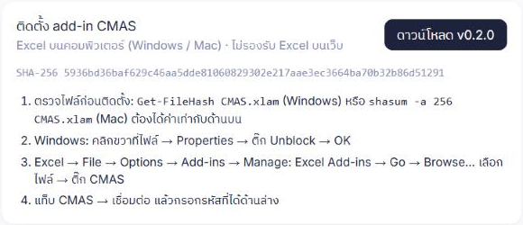
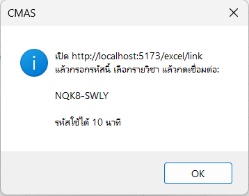
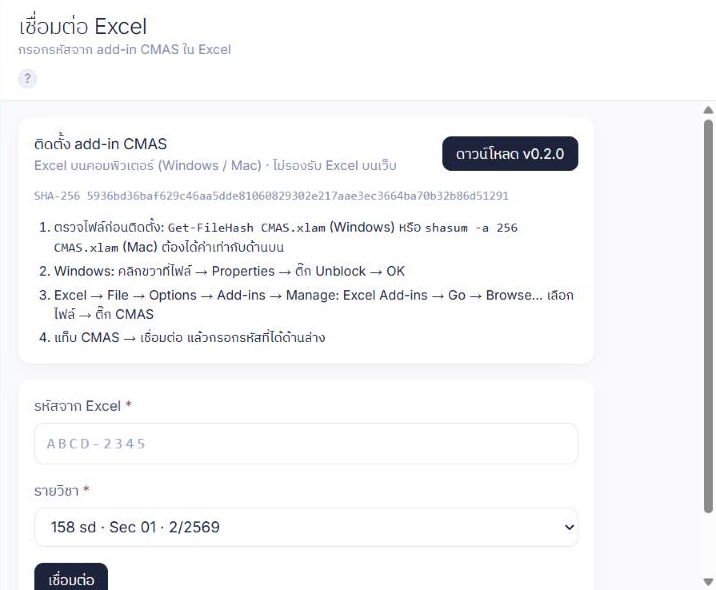
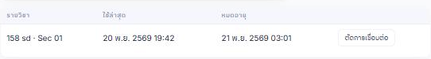
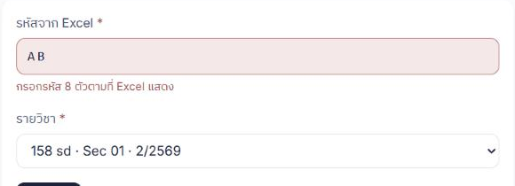

# คู่มืออาจารย์: กรอกคะแนนใน Excel ให้ขึ้น CMAS ทันที

> add-in CMAS รุ่น 0.2.0 · ใช้กับ Excel บนคอมพิวเตอร์ (Windows / Mac) · ไม่รองรับ Excel บนเว็บ, iPad และมือถือ
> ทดสอบแล้วบน Windows · **Mac ยังไม่ได้ทดสอบ**

add-in CMAS ทำให้ Excel กับ CMAS เห็นคะแนนชุดเดียวกัน:

- พิมพ์คะแนนใน Excel แล้ว CMAS บันทึกภายในราว 2 วินาที
- แก้คะแนนบนเว็บ แล้ว Excel อัปเดตภายในราว 10 วินาที

ไฟล์คะแนนเป็น `.xlsx` ธรรมดาที่ไม่มีมาโคร เก็บหรือส่งต่อได้ตามปกติ โค้ดทั้งหมดอยู่ใน add-in `CMAS.xlam`

## สิ่งที่ต้องมี

- Excel บน Windows หรือ Mac (Microsoft 365 หรือ Excel 2016 ขึ้นไป)
- บัญชี CMAS ที่เป็น **ผู้สอน** ของรายวิชา (ผู้ดูแลระบบใช้ไม่ได้ เพราะไม่ได้สอน)
- ที่อยู่ของ CMAS (ถามผู้ดูแลระบบ)

## ทางที่ง่ายกว่า: ไฟล์กรอกคะแนน .xlsm (ยังไม่เปิดให้ดาวน์โหลด)

ไม่ต้องติดตั้ง add-in และไม่ต้องกรอกรหัส

1. หน้า **นักศึกษาและคะแนน** ของรายวิชา → **Excel** → **ดาวน์โหลดไฟล์กรอกคะแนน (.xlsm)**
2. Windows ครั้งแรก: คลิกขวาที่ไฟล์ → **Properties** → ติ๊ก **Unblock** → OK
   (หรือเก็บทุกไฟล์ไว้ในโฟลเดอร์เดียวที่ตั้งเป็น Trusted Location ใน Excel แล้วไม่ต้อง Unblock อีก)
3. เปิดไฟล์ภายใน 10 นาทีหลังดาวน์โหลด แล้วไฟล์จะเชื่อมต่อเองและขึ้นรายชื่อพร้อมคะแนน
4. เปิดครั้งต่อไป: เบราว์เซอร์เปิดหน้า CMAS ที่กรอกรหัสและเลือกวิชาไว้แล้ว กด **เชื่อมต่อ** ครั้งเดียว

ไฟล์นี้เป็นของวิชาเดียว เก็บไว้ในเครื่องหรือ OneDrive ของคุณเอง และเปิดด้วยแอป Excel (Excel บนเว็บรันมาโครไม่ได้)
ไม่ต้องใช้ add-in คู่กับไฟล์นี้

## 1. ดาวน์โหลด add-in

1. ล็อกอิน CMAS แล้วเปิดหน้า `<ที่อยู่ CMAS>/excel/link`
2. กด **ดาวน์โหลด v0.2.0** จะได้ไฟล์ `CMAS.xlam`

หรือจากหน้า **นักศึกษาและคะแนน** ของรายวิชา กดปุ่ม **Excel** แล้วใช้กลุ่ม
**กรอกคะแนนใน Excel แบบซิงก์ทันที**: **ดาวน์โหลด add-in** ได้ไฟล์เดียวกัน
ส่วน **เชื่อมต่อ Excel** พาไปหน้า `/excel/link` โดยเลือกรายวิชานั้นไว้ให้แล้ว



> **ดาวน์โหลดจากหน้านี้เท่านั้น** CMAS ไม่ส่ง add-in ทางอีเมล ไฟล์ `.xlam` หรือ `.xlsm` ที่แนบมาในอีเมลไม่ใช่ของ CMAS ห้ามเปิด

## 2. ตรวจว่าไฟล์เป็นของ CMAS จริง

add-in ไม่มีลายเซ็นดิจิทัล จึงใช้ค่า SHA-256 ยืนยันแทน ค่าที่คำนวณได้ต้องตรงกับค่าที่หน้าเว็บแสดงทุกตัว

**Windows** เปิด PowerShell แล้วพิมพ์

```powershell
Get-FileHash $HOME\Downloads\CMAS.xlam
```

ผลที่ได้เป็นตัวพิมพ์ใหญ่ ส่วนหน้าเว็บแสดงตัวพิมพ์เล็ก ถือว่าตรงกัน

**Mac** เปิด Terminal แล้วพิมพ์

```bash
shasum -a 256 ~/Downloads/CMAS.xlam
```

ถ้าค่าไม่ตรง **อย่าติดตั้ง** ลบไฟล์แล้วแจ้งผู้ดูแลระบบ

## 3. ติดตั้งใน Excel

### Windows

1. ย้าย `CMAS.xlam` ออกจาก Downloads ไปไว้ในโฟลเดอร์ที่จะไม่ลบ เช่น พิมพ์ `%APPDATA%\Microsoft\AddIns` ในช่องที่อยู่ของ File Explorer (Excel จำตำแหน่งไฟล์ไว้ ถ้าย้ายทีหลัง add-in จะหาย)
2. คลิกขวาที่ไฟล์ → **Properties** → ติ๊ก **Unblock** → OK
   ถ้าข้ามขั้นนี้ Excel จะบล็อกมาโครทั้งหมดของไฟล์ (แถบสีแดง "Microsoft has blocked macros…")
3. เปิด Excel → **File → Options → Add-ins**
4. ด้านล่าง Manage เลือก **Excel Add-ins** → **Go…**
5. **Browse…** → เลือก `CMAS.xlam` → ติ๊ก **CMAS** → OK
6. จะมีแท็บ **CMAS** บน Ribbon มีปุ่ม เชื่อมต่อ, ตัดการเชื่อมต่อ, ซิงก์ตอนนี้, ใช้ค่าของฉัน, ใช้ค่าใน CMAS

ติดตั้งครั้งเดียว ครั้งต่อไปเปิด Excel แท็บ CMAS จะขึ้นเอง

### Mac (ยังไม่ได้ทดสอบ)

1. ย้ายไฟล์ไปไว้ในโฟลเดอร์ที่จะไม่ลบ
2. Excel → **Tools → Excel Add-ins…** → **Browse…** → เลือก `CMAS.xlam` → ติ๊ก CMAS → OK

## 4. เชื่อมต่อรายวิชา

1. แท็บ **CMAS → เชื่อมต่อ**
2. ครั้งแรก Excel ถามที่อยู่ของ CMAS ให้ใส่ที่อยู่ที่ผู้ดูแลระบบแจ้ง (ครั้งต่อไปจำไว้ให้)
3. Excel แสดงรหัส 8 ตัว ใช้ได้ 10 นาที

   

4. กด OK แล้วไปที่หน้า `/excel/link` บนเว็บ กรอกรหัส เลือกรายวิชา แล้วกด **เชื่อมต่อ**

   

5. กลับไปที่ Excel ภายใน 5 วินาทีจะมีเวิร์กบุ๊กใหม่เปิดขึ้น มีรหัสนักศึกษา ชื่อ และหนึ่งคอลัมน์ต่อกิจกรรม

การเชื่อมต่อหนึ่งครั้งใช้ได้กับ **1 รายวิชา นาน 8 ชั่วโมง** ถ้าสอนหลายวิชาให้กดเชื่อมต่อใหม่ทีละวิชา

## 5. กรอกคะแนน

| ทำอะไรใน Excel | ผล |
|---|---|
| พิมพ์ตัวเลข 0 ถึงคะแนนเต็ม | ส่งเข้า CMAS ภายในราว 2 วินาที ประวัติการแก้บนเว็บขึ้นว่า **แก้ใน Excel** |
| พิมพ์ `x` | **ยกเว้น** (ไม่นำมาคิดคะแนน) |
| ลบค่าในช่อง | ถามยืนยันก่อน ช่องว่างหมายถึง **ยังไม่ประเมิน** ไม่ใช่ 0 |
| พิมพ์ค่าเกินคะแนนเต็ม หรือตัวอักษรอื่น | ขึ้นเตือน แล้วค่าเดิมกลับมา |
| วางคะแนนทีละหลายช่อง | ส่งรวมกันในครั้งเดียว |
| ช่องสีเทา | แก้ไม่ได้: กิจกรรมปิดรับคะแนน หรือนักศึกษาถอนรายวิชาแล้ว |

**ช่องสีแดง** หมายถึงมีคนแก้ช่องเดียวกันบนเว็บไปก่อน ค่าของคุณยังไม่ได้บันทึก โน้ตในช่องบอกค่าที่อยู่ใน CMAS เลือกช่องแล้วกด

- **ใช้ค่าของฉัน** เพื่อเขียนทับด้วยค่าใน Excel
- **ใช้ค่าใน CMAS** เพื่อทิ้งค่าใน Excel

แถบสถานะด้านล่างของ Excel บอกว่าเชื่อมต่ออยู่หรือไม่ และตรวจล่าสุดเมื่อไร

## 6. เลิกใช้และความปลอดภัย

- **ปิด Excel** หรือกด **ตัดการเชื่อมต่อ** การเชื่อมต่อจบลง ไฟล์คะแนนยังอยู่ แก้ต่อได้ เชื่อมต่อใหม่เมื่อไรช่องที่แก้ไว้จะถูกส่ง
- ปุ่มตัดการเชื่อมต่อใน Excel ลืมการเชื่อมต่อเฉพาะในเครื่อง ถ้าต้องการให้สิทธิ์หมดทันที (เช่น ลืมปิดเครื่องที่ห้องพัก) ให้กด **ตัดการเชื่อมต่อ** ที่หน้า `/excel/link` ซึ่งแสดงทุกการเชื่อมต่อที่ยังใช้ได้

  

- ไม่มีรหัสผ่านหรือโทเคนอยู่ในไฟล์ Excel ส่งไฟล์ให้คนอื่นได้โดยไม่ต้องกังวลเรื่องสิทธิ์
- add-in แก้ได้เฉพาะคะแนนของวิชาที่เลือก แก้การตั้งค่ารายวิชาหรือดูวิชาอื่นไม่ได้

## ปัญหาที่พบบ่อย

| อาการ | วิธีแก้ |
|---|---|
| ไม่เห็นแท็บ CMAS | File → Options → Add-ins → Go… ดูว่าติ๊ก CMAS แล้ว ถ้าไม่มีในรายการ ให้ Browse… เลือกไฟล์อีกครั้ง |
| แถบสีแดง "Microsoft has blocked macros" | ปิด Excel แล้วทำขั้น Unblock (ข้อ 3.2) |
| "เริ่มเชื่อมต่อไม่ได้ (HTTP 0)" | ที่อยู่ของ CMAS ผิด หรือไม่มีอินเทอร์เน็ต กดเชื่อมต่อใหม่แล้วแก้ที่อยู่ |
| "รหัสหมดอายุ" | เกิน 10 นาที กด CMAS → เชื่อมต่อ ใหม่ |
| หน้าเว็บขึ้น "กรอกรหัส 8 ตัวตามที่ Excel แสดง" | รหัสไม่ครบ ตรวจตัวอักษรอีกครั้ง (ไม่มีตัว O, I, 0, 1) |
| "การเชื่อมต่อหมดอายุหรือถูกตัด" | ครบ 8 ชั่วโมงหรือถูกตัดที่หน้าเว็บ กดเชื่อมต่อใหม่ ช่องที่แก้ไว้ยังไม่หาย |
| "มี add-in รุ่นใหม่" | ดาวน์โหลดรุ่นใหม่จากหน้า `/excel/link` แล้วติดตั้งทับตามขั้นตอนเดิม |


